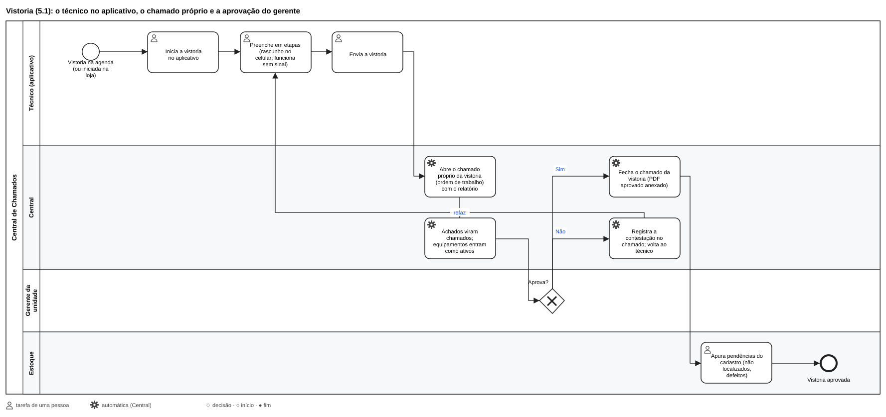

# Vistoria técnica

Vistoria preventiva das unidades: a contagem e o estado dos equipamentos, a infraestrutura, os serviços, os softwares e
os acessos, com a nota de saúde, as fotos, os achados (que viram chamados) e o relatório em PDF. O técnico faz pelo
aplicativo, o gerente da unidade aprova, e a TI acompanha pelo painel (menu **Vistorias**, papel *Vistorias*).

## Em uma página

1. A TI prepara uma vez: o **checklist** (modelo), os **kits** (o que cada tipo de unidade deve ter) e a **agenda**.
2. O **técnico** inicia a vistoria no aplicativo, na unidade, preenche em etapas (funciona sem sinal) e envia.
3. Ao enviar, nascem o **chamado da vistoria** e um chamado para cada **achado** marcado.
4. O **gerente da unidade** aprova (ou contesta, com o motivo) pelo aplicativo. A aprovação fecha o chamado da
   vistoria.
5. A TI acompanha a nota de cada unidade, os achados e os equipamentos encontrados.

## Preparar (uma vez, no painel)

Menu **Vistorias**, abas:

- **Configurações**:
  - **Categoria do chamado da vistoria**: cada vistoria abre um chamado (requisição) nesta categoria; os achados
    abrem incidentes sem categoria, para a equipe classificar. Se a categoria guardada não existir na Central (ficou da
    4.x, quando era o número da categoria no GLPI), ela é ignorada, vale a automática e o `verificar` avisa para escolher
    de novo;
  - **Kits** (ex.: Loja, Depósito, Escritório) e os **equipamentos de cada kit**, com a quantidade esperada;
  - os **tipos de equipamento**, com a marcação de **crítico**.
- **Modelos de checklist**: as seções e os itens. Cada seção vira uma tela no aplicativo do técnico e entra numa das
  três notas de saúde (equipamentos, serviços e softwares, acessos). Tipos de item: *conforme* (Conforme / Não conforme
  / Não se aplica), *estado* (Bom, Regular, Ruim, Inoperante), *número* (com mínimo e/ou máximo: fora deles, reprova),
  *escolha* (opções separadas por ponto e vírgula; marque com `*` as que reprovam, ex.: `Sim; Não*`), *texto* e *só
  foto*. Item **crítico** pesa três vezes e, reprovado, limita a nota do grupo a 59. **Pré-visualizar** abre a tela do
  técnico com o modelo como está (sem salvar): responda como um técnico e veja as notas, os chamados e o relatório.
- **Unidades**: cada unidade com o kit, os equipamentos (ativos, previstos e a validar), a última vistoria com a nota e a
  agenda (periodicidade, próxima e responsável). Na ficha da unidade: o **resumo**, os
  **equipamentos** que o técnico confere em toda vistoria (com o botão que acrescenta como *previsto* o que falta pelo
  kit), a **agenda** e as vistorias feitas.
- **Agenda**: a periodicidade de cada unidade e o responsável (um técnico ou qualquer técnico). Em ordem de data: as
  atrasadas primeiro, depois as próximas; as próximas também aparecem no Calendário.

Quem aprova é o **gerente** marcado no vínculo da pessoa com a unidade (**Usuários**, na ficha da pessoa).

## Fazer a vistoria (técnico, no aplicativo)

1. Na mesa do aplicativo, **🔎 Vistorias**: as programadas (com **Iniciar vistoria**) e as em andamento. Para uma
   vistoria fora da agenda, **Nova vistoria**: escolha a unidade e **Iniciar**.
2. Preencha em **etapas**:
   - **Equipamentos**: confira os da lista da unidade e **cadastre os encontrados** fora dela;
   - as **seções do checklist**, com as notas e as fotos;
   - os **achados**: marque os que viram chamado;
   - a **assinatura**.
3. Tudo fica guardado no celular (**rascunho**, com as fotos) e funciona **sem sinal**: dá para fechar e voltar depois.
   O envio espera a conexão e nunca é registrado duas vezes.
4. **Enviar**. Depois, se o gerente assinou o relatório impresso, **anexe** a foto ou o PDF; o relatório em PDF fica para
   baixar.

## Aprovar (gerente da unidade, no aplicativo)

**🔎 Vistorias**, na tela inicial, com as que esperam por você: abra o relatório e **Aprove** ou **Conteste** (diga o
motivo: a vistoria volta ao técnico). O PDF fica disponível nas duas situações. Detalhes no
[Manual do gerente](05-manual-gerente.md).

## Acompanhar (painel)

- **Histórico de vistorias**: as vistorias feitas, a nota, os achados e o **relatório em PDF**. Na vistoria:
  - a **nota de saúde** (verde a partir de 80, amarelo de 60 a 79, vermelho abaixo de 60), a contagem, os equipamentos
    e as observações;
  - **Relatório assinado**: anexe a foto ou o PDF do relatório que o gerente assinou no papel;
  - **Reenviar**: abre os chamados que não puderam ser abertos no envio (o `verificar` lista as vistorias com chamado a
    abrir; a aprovação do gerente também abre o que faltou);
  - **Cancelar vistoria**.
- **Equipamentos** (Vistorias › Equipamentos): os cadastrados na vistoria ficam **a validar** até a TI conferir
  (**Validar**, **Validar todos**); **Baixar** e **Reativar** mudam a situação (e, com o Estoque, a situação de uso, com o
  histórico); **Remover** tira da lista um *previsto* pelo kit que não existe na unidade; **Exportar CSV**.
- **Indicadores**: com o Grafana, o dashboard **Vistoria técnica** (Indicadores › Vistoria técnica) mostra as notas por
  unidade e por mês, os itens que mais reprovam, a agenda atrasada e as garantias vencendo
  ([Indicadores e TVs](08-dashboards.md)).

## No atendimento e no estoque

- Cada vistoria tem o **seu chamado** (requisição), com o relatório anexado; os **achados** viram incidentes. A
  aprovação do gerente fecha o chamado da vistoria; a contestação e o relatório assinado ficam registrados nele.
- Os equipamentos encontrados entram como ativos da unidade. Com o **Estoque**, ganham patrimônio na hora; os
  **ausentes** aparecem em *Não localizados* e os **ruins ou inoperantes** em *Com defeito* no estoque
  ([Estoque](18-estoque.md#inventário-e-conferência)).

## Problemas comuns

| Situação | O que fazer |
| --- | --- |
| O `verificar` avisa que a categoria da vistoria não existe | Escolha de novo em Vistorias › Configurações › Categoria do chamado da vistoria |
| A vistoria foi enviada, mas um chamado não abriu | Na vistoria (Histórico), **Reenviar**; a aprovação do gerente também abre o que faltou |
| O gerente não vê a vistoria para aprovar | Confira em Usuários se a pessoa está marcada como gerente no vínculo com a unidade |
| O técnico ficou sem sinal no meio | Continue: o rascunho fica no celular e o envio acontece quando a conexão voltar |
