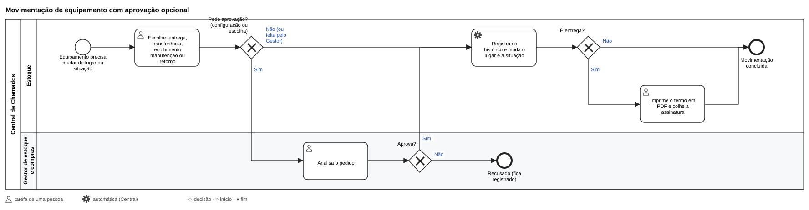
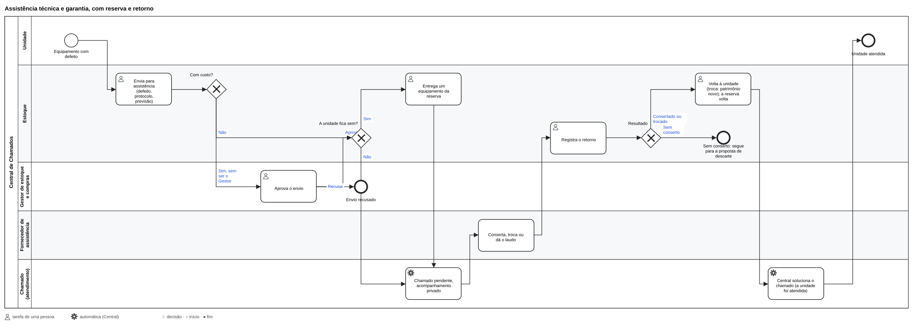
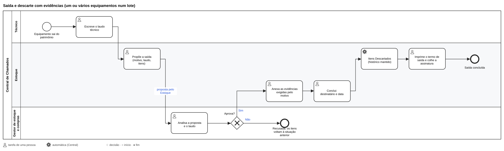
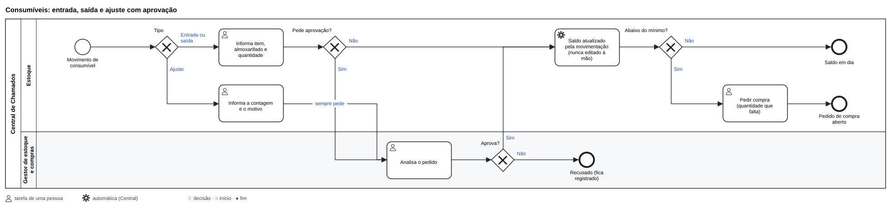

# Estoque de TI

Manual de quem cuida dos equipamentos e dos consumíveis de TI. O módulo **📦 Estoque de TI** (painel › Módulos)
acompanha cada equipamento da compra ao descarte e o saldo dos consumíveis em cada almoxarifado. As compras têm o seu
próprio manual: [Compras](24-compras.md).

## O essencial

- **Um cadastro só.** Os equipamentos do estoque são os mesmos da vistoria: a vistoria confere e cadastra, e o estoque
  acrescenta o patrimônio, a situação de uso, o lugar, a compra e o histórico.
- **Patrimônio gerado pela Central:** prefixo da empresa e sequência de 6 dígitos (ex.: `TDC-000001`). Nunca é
  reaproveitado, nem depois do descarte.
- **Tudo tem histórico:** cada cadastro, entrega, transferência, recolhimento, manutenção, assistência e saída fica na
  ficha do equipamento, com quem fez, quando, o motivo e o chamado (opcional).
- **Lugar e situação só mudam por movimentação.** *Editar cadastro* muda só os dados (modelo, série, compra, garantia,
  valor).
- **O saldo dos consumíveis não se edita:** vem das entradas e saídas. Uma contagem diferente vira um **ajuste**, com
  motivo e aprovação do Gestor.

## Quem faz o quê

| Ação | Estoque | Compras | Gestor de estoque e compras | Financeiro |
| --- | --- | --- | --- | --- |
| Equipamentos: cadastrar, editar, movimentar, termo | Sim | Só consulta | Sim | Só leitura, com nota e valor |
| Assistência técnica e proposta de saída | Sim | — | Sim (aprova) | — |
| Consumíveis: entrada, saída, pedido de ajuste | Sim | Só consulta do saldo | Sim (aprova o ajuste) | — |
| Pedir compra (estoque mínimo ou requisição) | Sim | Sim | Sim | — |
| Receber e entregar as compras | Sim | Acompanha | Sim | — |
| Aprovações e Configuração | — | — | Sim | — |
| Ver valores (inclusive o valor na ficha do equipamento) | **Não** | Sim | Sim | Sim |

O **Administrador** pode tudo. Atendimento e Vistorias não veem o estoque. **Ninguém aprova o próprio pedido**; quando o
Gestor faz uma ação que pede aprovação, ela vale como aprovada por ele.

## Antes de começar (uma vez)

1. **Ligue o módulo** em painel › Módulos (📦 Estoque de TI).
2. **Dê os papéis** em **Usuários**: *Estoque*, *Compras*, *Gestor de estoque e compras* e *Financeiro* (uma pessoa pode
   ter vários). Os avisos vão pelo sino, pelo push do celular e pelo e-mail reserva.
3. Em **Estoque › Configuração** (Gestor):
   - o **prefixo do patrimônio** (de 1 a 8 letras ou números, ex.: `TDC`; trocar vale só para os próximos);
   - **o que pede aprovação** do Gestor: entrega, transferência, recolhimento, envio e retorno da manutenção, entrada e
     saída de consumíveis (o ajuste de saldo pede sempre). Por padrão, só o ajuste;
   - os **almoxarifados** e o **almoxarifado padrão** (vem preenchido nos recebimentos, recolhimentos e entradas). Sem
     almoxarifado ainda: **Criar o almoxarifado da TI**;
   - os **tipos de equipamento** (os mesmos da vistoria; *crítico* se marca em Vistorias);
   - as **cotações do padrão** das compras.
4. **Carga inicial:** faça a primeira rodada de **vistorias** nas unidades ([Vistoria](13-vistoria.md)): o que o técnico
   encontra entra no cadastro já com patrimônio. O que está no almoxarifado, cadastre em **Cadastrar equipamento**.
5. Equipamentos que já estavam na vistoria antes do módulo: em Configuração, **Gerar os patrimônios que faltam**, e anote
   os números nos equipamentos.

## As telas

O menu **Estoque** tem as abas abaixo; o contador do menu mostra as aprovações que esperam por você.

| Aba | Para quê |
| --- | --- |
| **Início** | Em uso, em estoque, em manutenção, em assistência (e as atrasadas), garantias vencendo, saídas em andamento, aprovações pendentes, **não localizados** na vistoria, consumíveis **abaixo do mínimo**; as compras por etapa; os próximos 7 dias do calendário |
| **Equipamentos** | Busca por patrimônio, série, modelo, fabricante ou responsável; filtros por unidade, tipo, situação, nota fiscal, fornecedor e período da compra; **Exportar CSV**; **Cadastrar equipamento** |
| **Assistência e saída** | Assistências em andamento e atrasadas, **garantias vencendo** (90 dias; em vermelho a partir de 30) e as saídas, com **Propor saída** |
| **Consumíveis** | O saldo por almoxarifado, o catálogo com o estoque mínimo, **Entrada, saída ou ajuste** e **Pedir compra** |
| **Aprovações** | O que espera o Gestor, com **Aprovar** e **Recusar**, e as decididas recentemente |
| **Configuração** | Veja *Antes de começar* |

**Ficha do equipamento:** a situação, onde está e com quem fica, o estado na última vistoria, o cadastro (nota fiscal,
pedido de origem, valor para quem vê), os chamados, o histórico e as ações **Movimentar**, **Editar cadastro**, **Anexar a
nota fiscal**, **Enviar para assistência** e **Propor saída**.

## Tarefas do dia a dia

### Cadastrar um equipamento

**Cadastrar equipamento** (no Início ou em Equipamentos): o **tipo**, o **modelo** e a **unidade ou almoxarifado** e a
**situação** (obrigatórios); o fabricante, o número de série, com quem fica, a sala ou setor e, se houver, o fornecedor,
a nota fiscal, a data da compra, a garantia, o valor e uma observação. O **patrimônio** é gerado ao salvar: anote no
equipamento. Os que vêm de uma compra são cadastrados sozinhos no recebimento
([Compras](24-compras.md#6-receber)), e os que a vistoria encontra, na vistoria.

### Entregar, transferir ou recolher

Na ficha do equipamento, **Movimentar**:

| Movimentação | De → para | Situação depois |
| --- | --- | --- |
| **Entrega** | De onde está → uma unidade (e, se quiser, a pessoa) | Em uso |
| **Transferência** | Unidade → outra unidade | Mantém |
| **Recolhimento ao almoxarifado** | Unidade → almoxarifado | Em estoque |
| **Envio para manutenção** | Fica no mesmo lugar | Em manutenção |
| **Retorno da manutenção** | Fica no mesmo lugar | Em uso (ou em estoque, no almoxarifado) |

Escolha **o que fazer**, **para onde** e **com quem fica** (na entrega), o **motivo ou observação** e, se houver, o
**chamado**. Se a movimentação pede aprovação (Configuração), ela fica em **Aprovações** até
o Gestor decidir. Na **entrega**, o histórico ganha o botão **Termo**: o termo de entrega em PDF, para imprimir e colher
a assinatura de quem recebeu.

### Mandar para a assistência técnica

No envio, **Loja ou contato da assistência** (opcional) escolhe para quem o equipamento vai, quando o fornecedor tem
um contato de assistência ou mais de uma loja ([Contatos e lojas](23-suprimentos.md#contatos-e-lojas)): o telefone e
o WhatsApp aparecem na ficha da assistência.

Em assistência (e aguardando descarte), o equipamento não se movimenta pelas movimentações comuns: só pela assistência
ou pela saída. O acompanhamento é pela aba **Assistência e saída** e pelo Calendário (as previsões de retorno).

1. Na ficha do equipamento, **Enviar para assistência**: o fornecedor (marcado como *assistência técnica* em
   Fornecedores), o defeito, o protocolo, o chamado de manutenção (opcional), a data de envio, a previsão de retorno e se
   está **na garantia** (vem marcado pela data da garantia da ficha).
2. **Com custo:** marque *Com custo*. Feito pelo Estoque, o envio espera a **aprovação do Gestor** em *Aprovações*; feito
   pelo Gestor, já vale como aprovado. O valor (estimado e final) só aparece para quem vê valores.
3. **Reserva:** se a unidade ficar sem o equipamento, escolha um da reserva (mesmo tipo, em estoque num almoxarifado): ele
   é entregue à unidade no mesmo passo.
4. O **chamado** fica pendente durante a assistência, com um acompanhamento privado.
5. **Retorno** (na ficha da assistência):
   - **Consertado:** volta à unidade (a reserva volta ao almoxarifado) ou fica no almoxarifado (a reserva fica com a
     unidade);
   - **Trocado pelo fabricante:** o equipamento novo ganha **patrimônio novo**, ligado ao antigo (*Substitui* /
     *Substituído por* na ficha), com a série e a garantia novas; o antigo sai do cadastro como Descartado, com o
     histórico;
   - **Sem conserto:** o equipamento volta ao almoxarifado e segue para uma **proposta de descarte**, com o laudo do
     fornecedor.
6. O chamado é **solucionado** quando a unidade é atendida (o equipamento voltou, ou a reserva ficou com ela). Sem
   conserto e sem reserva, o chamado segue pendente para a equipe decidir (uma compra, por exemplo).

### Dar saída (descarte, doação, venda, devolução, perda)

1. **Propor saída** (na ficha do equipamento ou em *Assistência e saída*): o motivo, o **laudo do técnico** e os
   equipamentos (um ou vários num lote, ex.: tudo o que vai para a recicladora), marcando os que **guardam dados**. Os
   itens ficam *Aguardando descarte*.
2. O **Gestor aprova** em *Aprovações* (ou recusa: os itens voltam à situação anterior). Proposta feita pelo Gestor já
   nasce aprovada.
3. O Estoque **anexa as evidências** e **conclui** com o destinatário e a data:

| Motivo | Evidências exigidas |
| --- | --- |
| Descarte (sem conserto, obsoleto) | Certificado de apagamento dos dados (itens que guardam dados) e comprovante da destinação (recicladora) |
| Doação | Apagamento dos dados e termo assinado por quem recebe |
| Venda | Apagamento dos dados e comprovante da venda |
| Devolução ao fornecedor | Comprovante de entrega |
| Furto, roubo ou perda | Boletim de ocorrência ou declaração |

4. Os equipamentos ficam **Descartados**: nunca são apagados, o histórico continua e o patrimônio não é reaproveitado.
   **Laudo técnico** e **termo de saída** saem em PDF no padrão de documento da Personalização.

### Consumíveis: entrada, saída e ajuste

Em **Consumíveis**:

1. **Cadastre o item** no catálogo, com o **estoque mínimo** (**Salvar item**; **Editar** depois).
2. **Entrada, saída ou ajuste**: o item, o almoxarifado (o padrão já vem marcado), o tipo e a quantidade.
   - **Entrada**: chegou material (fora de uma compra da Central; as compras entram sozinhas no recebimento).
   - **Saída**: o material foi usado ou entregue; informe **para a unidade** e, se houver, o **chamado**.
   - **Ajuste (quantidade contada)**: a contagem não bate com o saldo. Informe o que foi contado e o motivo; o ajuste
     sempre espera a aprovação do Gestor.
3. **Pedir compra**: no item abaixo do mínimo, abre o pedido de reposição com a quantidade que falta (não abre outro se
   já houver um em andamento para o mesmo item e almoxarifado).

O técnico também usa consumíveis pelo chamado, no aplicativo (veja *Estoque no chamado*).

### Receber e entregar uma compra

Quem tem o papel Estoque é avisado quando a compra é feita, com a entrega prevista. Quando chegar, abra o pedido em
**Compras** e siga [Compras › Receber](24-compras.md#6-receber) e [Entregar à unidade](24-compras.md#7-entregar-à-unidade):
cada equipamento ganha o patrimônio e entra em estoque; os consumíveis somam ao saldo; a entrega move os equipamentos
para a unidade, com o termo. O Estoque não vê os valores nem as propostas.

### Aprovar (Gestor de estoque e compras)

Em **Aprovações**: as movimentações, as entradas e saídas de consumíveis e os ajustes que pedem aprovação, os envios
para assistência **com custo** e as propostas de saída. **Aprovar** executa a ação; **Recusar** a desfaz (na saída, os
itens voltam à situação anterior).

### Inventário e conferência

- **Relatório de inventário por unidade** (Painéis › Relatórios), em PDF ou CSV, para conferir na unidade.
- A **vistoria** confere os equipamentos de cada unidade: o que estava **ausente** aparece em *Não localizados* no
  Início (apure e registre a transferência, se for o caso); o que está **ruim ou inoperante** aparece até ir para a
  manutenção; o que foi encontrado fora da lista entra no cadastro com patrimônio.
- **Baixar** e **reativar** na tela de equipamentos da vistoria também mudam a situação no estoque, com o histórico.
- Exporte a lista filtrada em **Equipamentos › Exportar CSV**.

## Estoque no chamado

No **aplicativo do técnico**, a ficha do chamado aberto mostra **📦 Equipamentos e itens**: o que já está ligado e o pedido
de compra; **ligar** um equipamento da unidade; **trocar** um da unidade por um do almoxarifado padrão (o que sai vai para
o estoque ou para a manutenção, com o motivo); **usar um consumível** (com o saldo; sem saldo, recusa); **pedir compra**,
que abre o subchamado de aquisição e deixa o chamado aguardando. Tudo segue as aprovações configuradas, sem valores. No
painel, a ficha do chamado liga os ativos e abre a aquisição.

## Painéis, relatórios e calendário

Menu **Painéis** (Estoque, Compras, Financeiro, Gestor; valores em reais só para quem os vê):

| Aba | O que mostra |
| --- | --- |
| **Compras** | Funil por etapa com o tempo médio em cada uma (12 meses), parados, entregas atrasadas, prazo prometido x real (% no prazo e atraso médio), exceções de cotação, divergências; valor por mês, por categoria e por fornecedor, e a diferença entre a escolhida e a mais cara (e a mais barata) homologada |
| **Estoque** | Por situação, por unidade (tabela), idade do parque pela data da compra, sem nota fiscal, divergências da vistoria (não localizados, com defeito, a validar, série repetida), consumo de consumíveis (90 dias) |
| **Projeções** | Ruptura de consumíveis pelo consumo médio dos últimos 90 dias (o que acaba em até 30 dias), garantias vencendo, renovação por idade (mais de 5 anos), gasto comprometido (autorizado e não concluído), a pagar (vencimentos futuros) e a tendência (6 meses, com a projeção do mês) |
| **Terceiros** | Chamados pendentes por terceiro (pendências com fornecedor e acionamentos abertos) e o desempenho dos fornecedores: compras (atraso médio, divergências) e assistências (dias fora, atrasadas, sem conserto) |
| **Calendário** | Tudo, de todas as áreas (veja abaixo) |
| **Relatórios** | Inventário por unidade, movimentações, compras com valores (Compras, Gestor, Financeiro) e termos emitidos, em PDF (padrão da Personalização) e CSV (todas as colunas), com período e unidade |

**Calendário** (menu *Calendário*): visões de **3 e 7 dias** (colunas por dia), **30 dias** (grade do mês) e **90 dias**
(lista por semana), filtros por tipo e o bloco **Atrasados**. Itens: chamados com tarefa planejada (Atendimento),
vistorias (Vistorias), entregas previstas (Estoque, Compras), validade das propostas (Compras, Gestor), vencimentos de
pagamento (Financeiro), garantias e retornos de assistência (Estoque, Gestor). No menu *Calendário* e no bloco **Próximos
7 dias** das telas iniciais (Início, Estoque, Compras, Financeiro), só o que os papéis da pessoa permitem; em *Painéis >
Calendário*, tudo. Sem lembretes em horários fixos.

## Fluxogramas (BPMN)

Os fluxos do módulo estão em BPMN 2.0 na pasta [`docs/fluxos`](fluxos/): cada `.bpmn` abre e edita no
[bpmn.io](https://demo.bpmn.io) ou no Camunda Modeler, e o `.svg` é a imagem. A fonte é o script
`docs/fluxos/gerar_fluxos.py` (`python3 docs/fluxos/gerar_fluxos.py` gera tudo de novo; o teste `test_fluxos` confere
que os arquivos estão em dia).

| Fluxo | Arquivo |
| --- | --- |
| Compra: do pedido à compra (propostas, avaliação, escolha, recusa) | [compra.bpmn](fluxos/compra.bpmn) |
| Recebimento, divergência e entrega, com a solução do chamado | [recebimento-entrega.bpmn](fluxos/recebimento-entrega.bpmn) |
| Movimentação de equipamento com aprovação opcional | [movimentacao.bpmn](fluxos/movimentacao.bpmn) |
| Consumíveis: entrada, saída e ajuste | [consumiveis.bpmn](fluxos/consumiveis.bpmn) |
| Vistoria e cadastro de equipamentos | [vistoria.bpmn](fluxos/vistoria.bpmn) |
| Assistência técnica e garantia | [assistencia.bpmn](fluxos/assistencia.bpmn) |
| Saída e descarte com evidências | [saida.bpmn](fluxos/saida.bpmn) |
| Ciclo de vida do chamado, com o cancelamento | [chamado.bpmn](fluxos/chamado.bpmn) |

## Histórico do módulo

Equipamentos e vistoria (4.8), compras (4.9), papéis (4.10), revisão das compras (4.11), assistência e saída (4.12),
painéis, relatórios e calendário (4.14), revisão de uso (4.15). Na 5.1, Compras e Fornecedores viraram módulos próprios
(`/compras`, `/fornecedores`) e Compras passou a funcionar também sem o Estoque ([Suprimentos](23-suprimentos.md)).
Ainda não há catálogo de especificações padrão nem teto de gastos.
