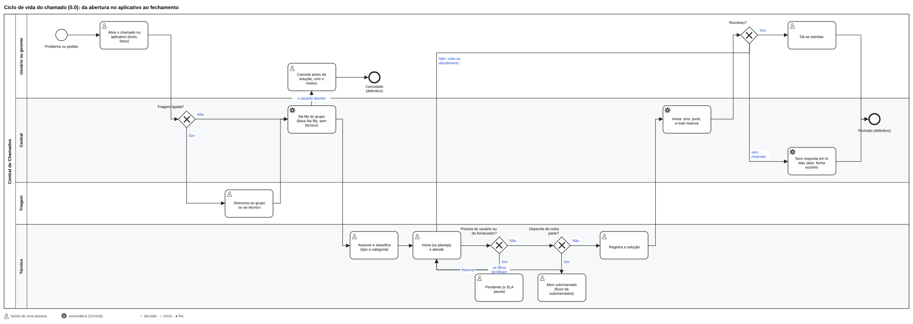
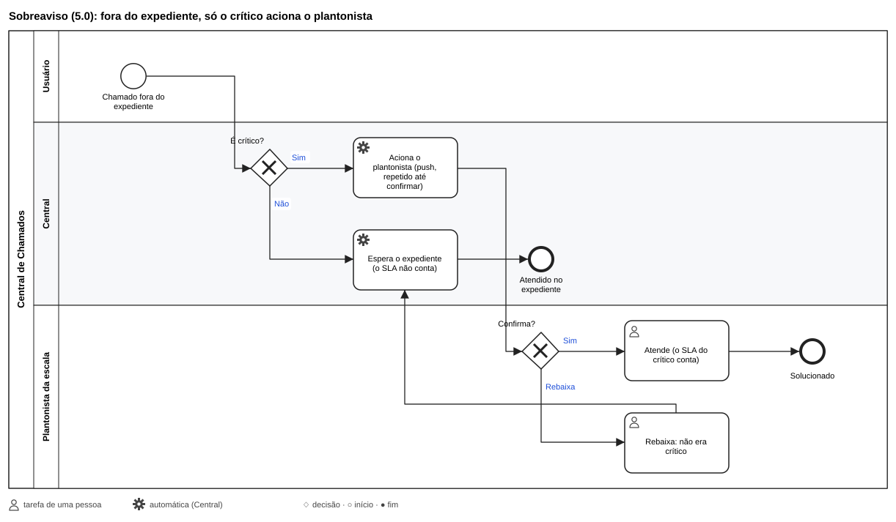
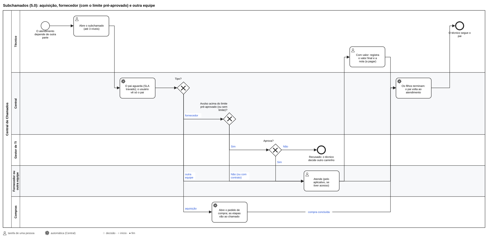

# Atendimento: como funciona

## Tipos e situações

**Tipos**: incidente (algo parou), requisição (um pedido) e ordem de trabalho (um serviço da TI que não é nenhum dos
dois). O usuário não escolhe: a TI classifica (tipo e categoria) na primeira ação de atendimento.

**Situações**: Novo → Na fila do grupo (sem técnico) → Em atendimento (assim que tem um técnico atribuído; ou Em
atendimento planejado) → Solucionado
→ Fechado. No caminho: **Pendente com o usuário** ou **com fornecedor** (o SLA pausa), **Aguardando aprovação
interna** (do Gestor de TI). **Cancelado** tem motivo e é definitivo. Solucionado fecha com a aprovação do usuário
(com estrelas) ou sozinho em N dias úteis; recusado, volta ao atendimento. Fechado não reabre. **Dia útil** é um dia
do expediente geral da TI (Atendimento › Configuração; sem ele, segunda a sexta) que não é feriado. No aplicativo, o
usuário vê a situação em linguagem simples ("Na fila da TI", "Aguardando outra equipe"...).

**Aberto pela TI em nome de alguém**: em "Abrir chamado", escolha o **solicitante** entre as pessoas cadastradas (busca
pelo nome): o chamado aparece no aplicativo dela e ela recebe os avisos. Só para quem não tem cadastro, escreva o nome à
mão. A **origem** (telefone, WhatsApp, presencial...) aparece na ficha.

## Roteamento

Sem triagem, o chamado novo cai na fila do grupo de entrada; com triagem, a triagem direciona. A categoria e o
equipamento só **sugerem** o grupo (o equipamento manda mais que a categoria); quem atende sempre pode escolher outro.

## Prioridade e SLA (desligados de fábrica)

- **Prioridade** = urgência × peso da unidade × peso da categoria × peso do ativo, com os pesos começando em 1. O
  Gestor de TI pode **priorizar à mão** (fica registrado) e devolver ao cálculo.
- **SLA**: dois prazos (resposta e solução) por prioridade, contados no expediente da unidade e da TI, com feriados;
  as pendências pausam. Alerta ao técnico em 80%; estouro ao líder e ao Gestor de TI. O "horário geral" é o
  **expediente geral da TI**: a unidade sem calendário próprio segue só ele.
- **Sobreaviso** (módulo): fora do expediente, só o crítico aciona o plantonista da escala. A escala aparece no
  **calendário** (camada "Sobreaviso": quem está de plantão em cada dia).

## Subchamados

5.2.1: compra e terceiro entram pelo **Deixar pendente** (Pendente de compras, Pendente de terceiros), que abre uma
janela e gera o subchamado sozinho (na compra, o pedido). Os tipos se chamam **Compra** e **Acionamento de
terceiro**; a **outra equipe** é opcional (Atendimento › Configuração › Subchamados, desligada por padrão: para mudar
de equipe, troque o grupo).

O chamado do usuário pode depender de outros, até 3 níveis: **aquisição** (abre o pedido de compra e acompanha as
etapas), **acionamento de fornecedor** e **outra equipe**. O pai espera, com o SLA travado, e volta sozinho quando os
filhos terminam. O usuário (e o gerente da unidade) só vê o pai. Enquanto espera, dá para abrir outro subchamado (ex.:
um segundo acionamento). O fornecedor só vê o acionamento **depois da aprovação** (quando ela é necessária); se o
Gestor de TI **não aprova**, o acionamento é encerrado ("Não aprovado pelo Gestor de TI") e o chamado original volta
sozinho ao atendimento.

**Quando o filho é solucionado** (5.1.0-rc5): o subchamado de **outra equipe** (entre níveis de atendimento) **fecha
ao ser solucionado**, e o chamado do usuário volta sozinho ao atendimento. O **acionamento de fornecedor** e a
**aquisição** continuam esperando a confirmação da TI (aprovar ou recusar a solução), porque envolvem serviço ou compra
de terceiros.

**Acionamento que precisa de compra** (ex.: a manutenção do ar pede um compressor novo): se o próprio fornecedor
fornece a peça, ela entra no valor do serviço (com o limite e a aprovação de sempre). Se a empresa compra, o fornecedor
deixa o acionamento **pendente com a TI** dizendo o que falta, e a TI usa "Comprar o que o fornecedor pediu": abre um
subchamado de **aquisição** debaixo do acionamento (o pedido de compra segue em Compras). O fornecedor vê "Aguardando a
TI comprar um item"; concluída a compra, o acionamento volta sozinho e o fornecedor termina o serviço. O chamado do
usuário espera o tempo todo, com o SLA da TI parado.

### Serviço do fornecedor

O acionamento de fornecedor precisa do módulo **Fornecedores**; o valor, o limite e o pagamento, do módulo **Serviços e
contratos** ([Suprimentos](23-suprimentos.md)).

No acionamento: o **serviço com contrato** ou **avulso** e o **valor combinado**. Com contrato, não pede aprovação;
avulso até o **limite pré-aprovado** do fornecedor segue direto; acima (ou sem limite), espera a aprovação do Gestor
de TI. Depois da solução, o técnico registra o **valor final** e a **nota ou recibo** (fica a pagar); o pagamento é
marcado em **Serviços a pagar**. Os indicadores mostram o gasto por fornecedor.

## Crédito e indicadores

A solução conta, nos indicadores, para **quem a registrou**; o técnico atribuído continua atribuído (a ficha mostra
"Solucionado por" quando foi outra pessoa).

## Programados

Chamados que abrem sozinhos numa frequência (diária, semanal, mensal...), para atividades pontuais e repetidas (trocar
filtro, renovar certificado), um por unidade, sem duplicar.

## Auditoria

Toda mudança fica registrada: na linha do tempo do chamado (o que o usuário pode ver e o privado da equipe) e na
**Auditoria** (todas as mudanças do sistema, com autor, data e origem).

## Os fluxos em BPMN

Os desenhos acima e os do estoque (compra, recebimento e entrega, assistência, consumíveis, movimentação, saída) estão
em `docs/fluxos/`, em BPMN 2.0: os `.bpmn` abrem e editam no [bpmn.io](https://demo.bpmn.io) ou no Camunda Modeler. A
fonte é `docs/fluxos/gerar_fluxos.py` (`python3 docs/fluxos/gerar_fluxos.py` gera os arquivos de novo).
