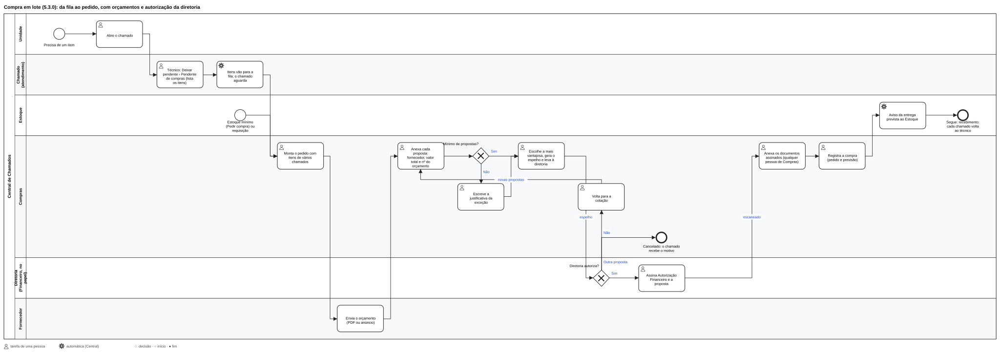
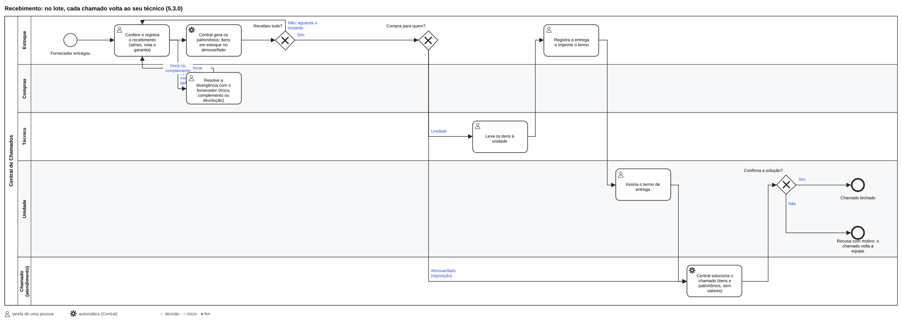

# Compras

Manual de quem pede, cota, avalia, autoriza, recebe e entrega as compras de TI. O módulo **🛒 Compras** (painel ›
Módulos) funciona com ou sem o **📦 Estoque**; o que muda sem ele está em [Sem o Estoque](#sem-o-estoque). Fornecedores
e serviços: [Suprimentos](23-suprimentos.md). Equipamentos e consumíveis: [Estoque](18-estoque.md).

## Em uma página

**5.3.0: compras em lote.** O que os chamados pedem **não abre pedido sozinho**: vira item na **fila de compras**, e um
comprador junta os itens que fazem sentido num pedido só. Uma cotação atende vários chamados.

**5.14.0: o Gestor decide e o Financeiro assina a proposta.** Cada proposta é o **documento do fornecedor** (fornecedor,
valor total, nº do orçamento, **condição: Faturado, Cartão ou Pix**, **validade** e o arquivo). Compras registra as
propostas e **envia ao Gestor**, sem escolher; o **Gestor de estoque e compras decide** e envia ao Financeiro; o
**Financeiro assina a proposta do fornecedor** (o espelho do pedido é só um resumo, sem assinatura); Compras anexa a
proposta assinada e registra a compra **com a prova** (a proposta enviada ao fornecedor, no faturado; o comprovante, no
Pix ou cartão). As 35 regras validadas em 27/11/2026 estão no manual de Compras ("Como fazer?"), em vermelho, e cada
formulário do pedido mostra as suas (`compras.REGRAS`).

**Etapas:** Em cotação → **Com o Gestor** → **Com o Financeiro** → Autorizado → Comprado → Recebido (em parte ou todo)
→ Concluído. Com o Financeiro fora do sistema (o caso da Tudo), "Com o Financeiro" é a proposta assinada no papel; com
alguém no papel Financeiro, ele autoriza no sistema. Fins sem compra: **Cancelado** (antes de *Comprado*) e
**Recusado** (pelo Gestor ou pelo Financeiro), sempre com o motivo.

| Quem | O que faz | Onde |
| --- | --- | --- |
| **Técnico** (ou quem atende o chamado) | Lista o que precisa comprar; os itens vão para a fila. Retira no almoxarifado quando chega, instala e soluciona o chamado | Ficha do chamado › **Deixar pendente › Pendente de compras** |
| **Estoque** | Pede reposição ou faz uma requisição; recebe e entrega (com o Estoque ligado) | Menu **Compras** · **Estoque** |
| **Compras** | Cuida da fila (deixa os itens mais específicos), monta os pedidos, pede os orçamentos, registra as propostas, envia ao Gestor, leva a proposta aprovada ao Financeiro, anexa a proposta assinada, registra a compra com a prova, resolve divergências | Menu **Compras** e **Compras › Fila de compras** |
| **Gestor de estoque e compras** | Decide a proposta (o motivo, fora a de menor valor), autoriza a exceção de cotações, devolve ou recusa, reorganiza a etapa e **cancela** (o pedido ou o item da fila; 5.14.4) | Ficha do pedido › **Decidir a proposta** |
| **Diretoria (Financeiro)**, fora do sistema | Assina a **proposta do fornecedor** aprovada pelo Gestor | O papel |
| **Financeiro** (no sistema, se houver) | Escolhe a condição de pagamento, autoriza, devolve ou recusa | Menu **Financeiro** |

**Regras que valem sempre:**
- **Ninguém aprova o próprio pedido.** Quem enviou ao Gestor não decide a proposta (o Administrador fica de fora da
  regra); quem enviou pela TI não autoriza pelo Financeiro.
- **O Estoque não vê valores nem propostas.** Compras, o Gestor e o Financeiro veem.
- **Não há lembretes em horários fixos.** O que está parado (2 dias ou mais na etapa) ou atrasado aparece em vermelho
  na tela Compras e no contador do menu de quem precisa agir.

## Antes de começar (uma vez)

1. **Ligue o módulo** em painel › Módulos › 🛒 Compras (e o 🏢 Fornecedores, que ele usa).
2. **Dê os papéis** em **Usuários**, na ficha de cada pessoa: *Compras*, *Gestor de estoque e compras*, *Financeiro* e,
   para quem recebe e entrega, *Estoque*. Uma pessoa pode ter vários.
3. **Dados da empresa** (Personalização › Dados da empresa, administrador): razão social, CNPJ, endereço e o e-mail para
   cotações. Eles saem no pedido de orçamento e na ordem de compra.
4. **Cotações do padrão** (Estoque › Configuração › Compras, só o Gestor): quantas propostas a compra precisa (padrão
   3, de 1 a 10) e se a Central avisa quem precisa agir em cada etapa. Sem o módulo Estoque, essa tela não aparece e
   vale o padrão de 3.
5. **Fornecedores** marcados como *vende* (menu **Fornecedores**). Um fornecedor novo também pode ser cadastrado direto na
   proposta (veja abaixo).

## 1. Pedir uma compra

- **Pelo chamado (o mais comum).** Na ficha do chamado, **Mais ações › Deixar pendente › Pendente de compras** (no
  painel ou no aplicativo do técnico): abre uma janela com **uma linha por item** (quantidade e descrição). A Central
  cria o subchamado de compra (nº X.1) e manda os itens para a **fila de compras**; **nenhum pedido nasce aqui**. O
  chamado fica **pendente** e volta ao técnico quando a compra chega ao almoxarifado.
  Escreva do seu jeito: se não souber o modelo, descreva o problema ("toner da impressora da loja 3"). Compras deixa
  mais específico antes de pedir orçamento, e o texto original continua visível.
- **Reposição e requisição** continuam abrindo pedido direto (não passam pela fila): são do estoque, não de um chamado.
- **Reposição de consumível** (com o Estoque): em *Estoque › Consumíveis* ou no início do estoque, **Pedir compra** no item
  abaixo do mínimo abre o pedido com a quantidade que falta. Se já houver um pedido em andamento com o mesmo item e
  almoxarifado, ele não abre outro.
- **Requisição** (papel Estoque): *Compras › Nova requisição de compra*. Descreva o que precisa; Compras inclui os itens.
- **Pedido direto** (papel Compras): *Compras › Novo pedido de compra*.

## 1b. A fila de compras (5.3.0)

**Compras › Fila de compras** mostra o que os chamados pediram e ainda não entrou em pedido: quantidade, item,
**chamado**, **unidade de destino** e **há quantos dias espera**. O número de dias é só informação — quem julga a
urgência é a equipe; se algo for urgente, monte um pedido com um item só.

- **Um por um** ou **juntar os iguais** (soma os itens de mesma descrição e mostra cada chamado). O agrupamento é só da
  tela: no pedido, cada item continua separado, com o seu chamado e a sua unidade.
- **Mudar:** deixe o item mais específico — é esse texto que o fornecedor vai ler no pedido de orçamento. O que o
  técnico pediu fica guardado e aparece embaixo.
- **Cancelar o item:** só o **Gestor de estoque e compras** (5.14.4); exige o motivo e **avisa o técnico do chamado**,
  que decide o que fazer.
- **Montar pedido:** marque os itens que fazem sentido pedir ao mesmo fornecedor, informe o título e o almoxarifado que
  vai receber, e a Central abre **um pedido** com todos eles.

No pedido em lote, cada item mostra o **chamado** e o **destino**. Não se inclui nem remove item ali: a origem é a
fila. Se a proposta escolhida não cobrir algum item, use **Devolver itens para a fila** — ele volta a esperar e o
técnico do chamado é avisado de que vai demorar mais.

O número de um chamado pode ser informado na abertura ou depois, em **Editar**.

## 2. Cotar (Compras)

1. **Incluir os itens** (tipo, quantidade e especificação). Cada item mostra o **último preço pago**.
2. **Pedir as propostas** aos fornecedores (o **pedido de orçamento** em PDF, genérico, serve para todos: a mesma
   especificação para todos).
3. **Registrar cada proposta**: o **fornecedor** (da lista ou *+ Novo fornecedor*), o **nº do orçamento**, o **valor
   total** (com frete, se houver), a **condição de pagamento** (**Faturado**, **Cartão de crédito** ou **Pix**; parcelas e
   datas não entram na Central), a **validade** (obrigatória; proposta vencida não é aceita) e o **arquivo** do
   fornecedor, obrigatório. Print de anúncio não vale. Errou? **Revisar** abre uma nova rodada e a anterior fica no
   histórico.
4. O quadro das propostas mostra o **total** de cada uma (o menor em verde), a condição, a validade e o link **abrir o
   arquivo**.

## 3. Enviar ao Gestor e a decisão (Compras e o Gestor)

1. Em **Enviar ao Gestor**, Compras vê todas as propostas e clica em **Enviar ao Gestor**. Com menos propostas que o
   padrão, escreve a **justificativa**. Compras não escolhe nem recomenda (`enviar_para_aprovacao` ignora a escolha).
2. O **Gestor** decide em **Decidir a proposta** (`escolher_e_enviar`): proposta vencida não pode ser escolhida; fora a
   de menor valor, o **motivo da escolha** é obrigatório; com menos propostas que o padrão, autoriza a exceção. Quem
   enviou o pedido não decide (o Administrador fica de fora da regra). A escolhida fica fixada no pedido e homologada;
   as outras, *não escolhidas*. Ou **Devolver para completar as cotações** ou **Recusar a compra**, com o motivo.

## 4. Autorização do Financeiro (sem o Financeiro no sistema)

1. Compras leva ao Financeiro a **proposta do fornecedor** aprovada pelo Gestor. O **espelho do pedido** (PDF) é só um
   resumo para ler, **sem assinatura**.
2. O Financeiro **assina a proposta do fornecedor**. Com ela de volta, **qualquer pessoa de Compras**, em **Autorização
   do Financeiro**, preenche **Quem assinou pelo Financeiro**, anexa a **proposta do fornecedor assinada** e clica em
   **Anexar a proposta assinada**. O pedido fica **Autorizado** (no Pix ou cartão: aguardando o Financeiro pagar).
3. A assinatura vale para uma proposta, um valor e uma validade. O mesmo documento não pode ser anexado de novo (neste
   ou em outro pedido: a Central compara o conteúdo). Proposta vencida não é autorizada.
4. A diretoria pediu outra proposta: **Voltar para a cotação** (Compras ou o Gestor, com o motivo); a decisão do Gestor é
   desfeita e todas as propostas voltam a valer. Para desistir, o Gestor **cancela** (com o motivo).

### Com o Financeiro no sistema

Se alguém tiver o papel **Financeiro**, o caminho pelo sistema continua: o Gestor avalia e envia ao Financeiro, e o
Financeiro, no menu **Financeiro**, autoriza, devolve ao Gestor ou recusa.

## 5. Comprar (Compras)

Com o pedido **Autorizado** (filtro *autorizados, a comprar*), **Registrar a compra** só com a prova:

- **Faturado:** envie ao fornecedor a proposta assinada pelo Financeiro e marque **A proposta assinada pelo Financeiro
  foi enviada ao fornecedor**.
- **Pix ou cartão:** depois de o Financeiro pagar, anexe o **comprovante do pagamento** (fica nos anexos do pedido).

O **número do pedido no fornecedor** é opcional e não pode ser o nº do orçamento nem o nº da Central. A previsão de
entrega, as datas por item e **Retirar ou receber em** continuam como antes. Proposta vencida bloqueia a compra. Feita a
compra, a **Ordem de compra em PDF** continua disponível, se o fornecedor pedir.

Quem tem o papel Estoque é avisado da entrega prevista. Passada a data, o pedido fica em vermelho como **atrasado** (o atraso conta
pelo próximo item que falta).

## 5b. Compra travada (5.5.0)

A compra às vezes está pronta, mas não anda por um motivo de fora: o fornecedor não fatura enquanto houver boleto de
faturamentos anteriores em aberto, ou ainda não tem o produto. Antes, isso ficava num limbo entre a compra e a chegada
do material, sem registro em lugar nenhum.

- **Travar a compra** (no pedido, do Financeiro em diante: com o Financeiro, autorizado, comprado ou
  recebido em parte): o **motivo** (*Pendência financeira com o fornecedor*, *Aguardando o fornecedor* ou *Outro*), o
  **texto** do que está segurando (obrigatório; trava não é anotação de andamento) e, se houver, a **previsão de destravar**. Quem trava: Compras, o
  Gestor de estoque e compras, o Gestor de TI e o Administrador.
- **Não é etapa:** o pedido fica onde está. A trava aparece no pedido, no contador e na aba **Travados** de Compras,
  no **Depende de** de cada chamado que espera (com o motivo) e no **painel da liderança** (quadro *Compras
  travadas*). O chamado que espera uma compra travada **não conta como parado** contra o técnico: a espera não é dele.
- **Pendência financeira:** o fornecedor da proposta escolhida fica marcado (**⚠ pendência financeira**) em
  Fornecedores e ao registrar ou escolher uma proposta dele num pedido novo. A marca some sozinha quando o último
  pedido travado por isso destrava.
- **Destravar** pede o que mudou. Se o pedido seguir para a próxima etapa (compra feita, recebimento, cancelamento), a
  trava se encerra sozinha, com registro no histórico e no chamado.
- A loja não vê nada disso: para ela continua *Aguardando a aquisição de um item necessário*.

## 5c. Reorganizar a etapa (5.10.0)

O pedido tem de contar o que aconteceu de verdade. Quando um passo foi registrado por engano (a compra marcada antes de o
pagamento sair, como o pedido 11 em 19/11) ou a realidade andou por fora da Central (a diretoria pediu outra proposta,
a compra foi feita no balcão), o **Gestor de estoque e compras** (ou o Administrador) põe o pedido na etapa certa, em
**A etapa não bate com a realidade? Reorganizar a etapa**, na ficha do pedido.

- **Só antes do recebimento:** entre Em cotação, Com o Gestor (ou a diretoria), Com o Financeiro, Autorizado e
  Comprado, para trás ou para frente. Depois do recebimento há patrimônio e saldo no almoxarifado; cancelado, recusado
  e concluído não voltam por aqui.
- **Motivo obrigatório.** Fica no histórico do pedido (*Etapa reorganizada pela gestão*, com o que saiu do pedido), na
  auditoria (`compra_reorganizada`) e no chamado que espera a compra; Compras e quem abriu o pedido recebem o aviso.
  **Nada some do histórico:** o passo desfeito continua lá, com a correção logo depois.
- **Para trás**, o que as etapas desfeitas gravaram sai do pedido: o nº do pedido no fornecedor e as previsões (voltando
  de Comprado); a autorização, a condição e as datas de pagamento (voltando de Autorizado); o envio ao Financeiro
  (voltando de Com o Financeiro). A proposta escolhida por Compras (o caminho da diretoria, 5.2.6) continua escolhida,
  a não ser que o pedido volte para a cotação, quando todas voltam a ser candidatas; no caminho do Gestor, a escolha do
  Financeiro sai com a autorização.
- **Para frente**, do Financeiro em diante, é preciso dizer a **proposta que vale** (e, em Comprado, o nº do pedido no
  fornecedor, se houver). O pedido segue com ela, como se tivesse passado pelas etapas puladas; o histórico diz que foi
  uma reorganização. Use só para acertar o que já aconteceu: não é um atalho para pular a autorização.
- **Trava (5.5.0):** continua se o pedido ainda puder ser travado na etapa nova (ex.: de Comprado para Autorizado com o
  boleto em aberto); senão, encerra-se com o motivo, e a pendência do fornecedor é recalculada.
- **Painéis:** o funil da TV gerencial conta o pedido aberto pela etapa atual (antes, pelo ponto mais alto do
  histórico, que agora pode ter um passo desfeito) e "Compras por mês" só soma como comprado o pedido que ainda está de
  Comprado em diante.

## 5d. O contas a pagar do VR (5.12.0)

A Central lê o contas a pagar do VR (o ERP da Tudo, PostgreSQL) a cada 15 minutos, **só para leitura** (sessão em modo
somente leitura, 30 s por consulta), e grava um espelho pequeno no banco da Central (`vr_titulos`, `vr_notas`). As
telas leem só desse espelho. Código: `central/app/vr.py` (a leitura) e `central/app/compras/contas_vr.py` (as regras).

- **Ligar:** no `central/.env`, `VR_DB_HOST`, `VR_DB_PORT`, `VR_DB_NAME`, `VR_DB_USER` e `VR_DB_PASSWORD` (de
  preferência um usuário do VR só com leitura das tabelas `pagarfornecedor`, `pagarfornecedorparcela`, `fornecedor`,
  `loja`, `tipoentrada`, `notaentradaitem` e `produto` e, desde a 5.12.2, `notaentrada`, `notaentradavencimento`,
  `tipopagamento`, `banco`, `pagaragendamento`, `pagaragendamentoparcela`, `tipoagendamento`,
  `pagarfornecedorparcelahistoricoboleto`, `conciliacaobancarialancamento` e `conciliacaobancaria`). Sem `VR_DB_HOST`,
  nada disso aparece.
- **O que é lido:** os títulos dos fornecedores do cadastro, achados pela **raiz do CNPJ** (8 primeiros dígitos: todas as
  filiais). Em aberto com vencimento nos últimos 12 meses (o VR tem títulos de anos atrás nunca baixados) e as notas
  emitidas nos últimos 6 meses, com os itens. Compras de TI são os tipos de entrada de `VR_TIPOS_TI` (padrão
  107, 123, 126, 161 e 313); o resto é "outros setores". Fornecedor sem CNPJ no cadastro não é conferido (a tela avisa).
- **Sem trava automática (5.14.0):** o VR é só consulta, para saber de antemão o que está em aberto com o fornecedor.
  Até a 5.13.0 a Central travava sozinha o pedido do fornecedor com parcela vencida; desde a 5.14.0 ela não trava e solta
  as travas automáticas que ainda existirem na primeira leitura (`sincronizar_travas`), com o registro no histórico e no
  chamado. A tabela `vr_excecoes` (os destraves "mesmo assim") ficou sem uso.
- **Leitura com erro ou velha (mais de 2 h):** o espelho anterior fica e as telas avisam.
- **Nota e pagamento:** depois da compra, a Central liga a nota do VR ao pedido quando há **uma só** nota do mesmo
  fornecedor com o mesmo valor (até R$ 1,00 de diferença), emitida a partir de 3 dias antes da aprovação. Ligada (ou
  quando o VR muda as parcelas), **os vencimentos do pedido passam a ser os do VR**, com o registro no histórico
  ("Vencimentos pelo VR"). Sem nota única, a ficha sugere as mais parecidas (Compras liga); "Não é esta nota" desfaz e a
  Central não liga mais aquela nota àquele pedido (`vr_ligacoes`).
- **Telas:** o quadro do débito na ficha (com as outras propostas e o débito de cada fornecedor), o aviso em cada pedido
  da lista e o contador, e **Compras › Pendências financeiras** (o relatório para a diretoria: vencido por fornecedor,
  compras seguradas, chamados que esperam, o que vence em 7 dias e as notas de TI sem pedido ligado). Só para quem vê
  valores. O Grafana não mudou (decisão do Matheus, 25/11/2026).
- **Auditoria:** `vr_titulos` e `vr_notas` ficam fora (são substituídas a cada leitura); as ligações e as exceções
  entram. As travas e os destraves automáticos têm registro de ação próprio.

### O detalhe do débito, o "Já foi pago?" e os atrasados (5.12.2; enxuto na 5.12.4)

Pedido do Matheus (25/11/2026): mais detalhes da compra, **fora da tela inicial de Compras**, só ao clicar no débito; e,
depois do ensaio com o VR de verdade, **só o que é confiável** (o preenchimento do VR varia de pessoa para pessoa).

- **Do VR a Central usa só** o fornecedor (pelo CNPJ), a nota, a parcela, o vencimento, o valor, se está aberta ou paga, a
  loja e os itens da nota (do XML da NF-e). Observação, forma de pagamento, retorno do banco, juros e duplicatas não
  entram (as colunas da migração 46 ficaram sem uso). Nunca saem do VR: código de barras, agência nem conta.
- **Tela do débito** (`/compras/debito-vr/<raiz do CNPJ>`, só para quem vê valores), aberta pela marca 💳 da lista, por
  **Ver o detalhe do débito** na ficha do pedido e pelo nome do fornecedor no relatório: atrasado, a vencer e o pago
  segundo o Financeiro; cada nota em aberto com a data, a loja, os itens e as parcelas.
- **"Já foi pago?"** (Compras, Financeiro ou Gestor de TI), na parcela atrasada: a caixa **"Informado pelo financeiro que
  já foi pago"** e, opcional, quem informou. Fica só na Central (`vr_pagos_informados`, migração 47; o VR não muda): a
  parcela sai do débito na hora, **não vence**, e toda tela que a mostra diz que **no VR ainda consta em
  atraso**. Quando o VR dá a baixa, a marcação perde o efeito sozinha. **Desfazer** volta a contar. Entra na auditoria.
- **Atrasados** (Compras › Pendências financeiras), a lista para responder ao Jorge: por fornecedor, cada parcela vencida
  (nota e parcela, quando venceu e há quantos dias, valor, loja, o que foi comprado) e o que está segurando (pedidos e
  chamados, com as lojas); à parte, as informadas como pagas pelo Financeiro. **Copiar para o WhatsApp** copia o mesmo
  texto, arrumado por fornecedor e com o total.
- Sem regra de dias: vencido é vencido. Se o Financeiro já pagou e o VR ainda não baixou, é o "Já foi pago?".
- Débito de outros setores com o mesmo fornecedor também segura as compras da TI (confirmado pelo Matheus em 25/11).

## 6. Receber

Com o Estoque ligado, quem recebe é o **Estoque**; sem ele, **Compras**. O recebimento pode ser **parcial** (uma entrega
de cada vez). No pedido, **Receber**:

1. Escolha o **almoxarifado** (o padrão já vem marcado).
2. Para cada item: a **quantidade** que chegou, a **marca e o modelo** (vêm da proposta) e as **séries** dos
   equipamentos.
3. A **nota fiscal**: o número, a data da nota, a data da compra, a **garantia** (em meses, ex. `12`, ou uma data) e o
   arquivo. Para várias entregas com a mesma nota, a Central sugere as notas já registradas no pedido.

Com o Estoque, cada equipamento ganha o **patrimônio na hora** e entra **em estoque** no almoxarifado, com o valor, a
marca, o modelo e o fornecedor na ficha; os consumíveis somam ao saldo. Boleto com vencimento em dias após a nota: a data
é calculada aqui. Datas impossíveis são recusadas (garantia antes da compra, nota ou compra no futuro, nota antes da
autorização).

### Divergência

Chegou faltando, com outro modelo ou com defeito? Registre a **divergência** no próprio recebimento. As unidades com
problema não entram e o pedido volta para **Compras** resolver com o fornecedor:

- **Troca** ou **complemento**: as unidades continuam a receber;
- **Devolução sem reposição**: a quantidade do item diminui e o pedido pode se concluir.

## 7. Entregar à unidade

No **pedido em lote** não há esta etapa: ele conclui no recebimento e quem leva a peça até a loja é o técnico do
chamado (veja *O chamado de origem*). O que segue vale para os pedidos de um chamado só.

No pedido recebido (filtro *a entregar à unidade*), **Entregar** registra a entrega de tudo o que foi recebido e ainda não
foi entregue, com o **termo de entrega** em PDF para colher a assinatura. Com o Estoque, os equipamentos passam para a
unidade (em uso), com a movimentação no histórico.

## O chamado de origem

- Fica **pendente** durante a compra e recebe um **acompanhamento privado** a cada etapa, sem valores.
- **No pedido em lote (5.3.0):** recebida a compra no almoxarifado, o pedido **conclui ali** e cada chamado **volta ao
  seu técnico** — o subchamado de Compra fecha e o chamado é retomado, com a lista do que chegou. O técnico retira com
  o Estoque, instala e **soluciona o chamado**: quem sabe que o problema acabou é ele, não o sistema.
  Chamado que ainda espera item em outro pedido continua aguardando e só recebe o aviso do que já chegou; recebimento
  parcial não libera ninguém.
- **Nos pedidos de um chamado só** (reposição, requisição, pedidos anteriores à 5.3.0): é **solucionado** pela Central
  na **última entrega** à unidade ou, na reposição do almoxarifado, no **recebimento** total.

## Cancelar ou recusar

- **Cancelar** (antes de *Comprado*): **só o Gestor de estoque e compras**, com o motivo (5.14.4, decisão do Matheus
  em 27/11/2026; até a 5.14.3, também quem abriu o pedido e Compras). O Administrador pode tudo.
- **Recusar**: o Gestor ou o Financeiro, com o motivo.

Ao cancelar ou recusar, quem decide escolhe entre **Encerrar e avisar a unidade** (o chamado é cancelado, com
um acompanhamento visível à unidade com o motivo, sem pesquisa de satisfação) ou **Deixar com a equipe para outra
solução**. Recusada pelo Financeiro, o chamado **sempre volta para a TI**, e o Gestor e Compras são avisados. Um pedido
cancelado ou recusado não volta sozinho: para tentar de novo, abra outro.

## Avisos

Pelo **sino**, pelo **push** do celular (para quem ligou os avisos no aplicativo) e pelo e-mail reserva, para quem
precisa agir:

| Acontecimento | Quem é avisado |
| --- | --- |
| Pedido novo, pedido devolvido pelo Gestor | Compras |
| Propostas para avaliar, devolvido pelo Financeiro | Gestor |
| Homologadas enviadas | Financeiro; sem ninguém com o papel Financeiro, Compras e quem abriu (autorização em papel) |
| Autorizado | Compras e quem abriu |
| Compra feita, com a entrega prevista | Quem tem o papel Estoque |
| Divergência no recebimento / resolvida | Compras / Estoque |
| Cancelado ou recusado | Compras, Gestor e quem abriu |

Cada aviso tem o link da ficha, que abre **na rede interna**.

## Documentos (PDF)

Todos no padrão de documento da Personalização (papel timbrado e margens): **pedido de compra** (com a proposta
escolhida, é o **espelho** na página 1 e o arquivo da proposta nas seguintes, para as assinaturas; sem valores para o
Estoque), **pedido de orçamento**, **mapa comparativo**, **ordem de compra** (para o fornecedor escolhido) e
**termo de entrega**. Com o timbrado compacto (cabeçalho de até 3 cm, margens de 2,9 cm e 2,0 cm), o espelho cabe numa
página.

## Sem o Estoque

Compras funciona sozinho:

- Itens: **equipamento** e **outro item** (o **consumível** precisa do Estoque, porque vem do catálogo dele).
- **Compras recebe e entrega.** O recebimento registra as quantidades, as divergências, a nota e as **séries** (no
  registro), sem almoxarifado nem patrimônio. A entrega conclui o pedido e soluciona o chamado.
- A reposição pelo estoque mínimo não existe (é do Estoque).
- As **cotações do padrão** ficam em 3 (a tela de configuração é a do Estoque).
- O menu **Painéis** (com a aba Compras) também é do Estoque: sem ele, o acompanhamento é pela tela Compras e pelo
  Calendário.
- O aviso de "compra feita" vai para quem tem o papel Estoque: sem o módulo, acompanhe pelo filtro *a receber do
  fornecedor*.

## Painéis e calendário

- **Painéis › Compras**: o funil por etapa com o tempo médio em cada uma (12 meses), os parados, as entregas atrasadas,
  o prazo prometido × o real, as exceções de cotação e as divergências; para quem vê valores, o valor por mês, por
  categoria e por fornecedor, e a diferença entre a escolhida e a mais cara (e a mais barata) homologada.
- **Painéis › Projeções**: o gasto comprometido (autorizado e não concluído), o *a pagar* e a tendência dos 6 meses.
- **Painéis › Relatórios**: compras com valores (Compras, Gestor, Financeiro), em PDF e CSV, com período e unidade.
- **Calendário**: as entregas previstas (Estoque, Compras), a validade das propostas (Compras, Gestor) e os
  vencimentos de pagamento (Financeiro).

## Problemas comuns

| Situação | O que fazer |
| --- | --- |
| Não consigo mudar os itens | Já há proposta registrada: os itens travam. Remova as propostas ou abra outro pedido |
| "Enviar ao Gestor" pede justificativa | Há menos propostas válidas que o padrão: explique por que (fornecedor único, urgência) |
| O Financeiro não vê o botão de autorizar | Quem enviou pela TI não autoriza; outra pessoa com o papel Financeiro autoriza |
| O pedido está *com o Financeiro* e ninguém tem esse papel | Autorização em papel: imprima, colha a assinatura e anexe (passo 4) |
| O pedido está em vermelho | Parado há 2 dias ou mais na etapa, ou a entrega passou da previsão |
| O Estoque não vê os valores | É de propósito: só Compras, o Gestor e o Financeiro veem valores |
| O fornecedor não aparece na proposta | Ele precisa estar ativo e marcado como *vende* em Fornecedores |

## 5.3.2: nome do pedido, situação do subchamado e cancelamento

- O pedido montado da fila **exige nome** (e aceita descrição). O antigo "Compras em lote · data" obrigava a equipe a
  abrir o pedido para saber do que se tratava. **Editar** renomeia um pedido já existente.
- No pedido em lote, os campos "Para quem é" e "Chamado nº" não aparecem: o destino é o chamado de cada item.
- O **subchamado de Compra** não usa a régua dos técnicos. A situação dele é o estágio da compra — *Na fila de
  compras*, *Em pedido nº N*, *Comprado*, *Recebido*, *Compra cancelada* — e o número do pedido aparece ao lado, no
  atendimento, assim que o lote é montado.
- **Cancelado o último item vivo de um chamado, o subchamado é cancelado** (não solucionado: não houve solução) e o
  chamado de origem volta ao atendimento. Até a 5.3.1 nada fazia isso: o técnico recebia o aviso e o subchamado
  ficava aberto para sempre.

## 5.3.4: saída para o subchamado de Compra órfão

A ficha do subchamado de Compra esconde as ações do técnico de propósito (`sub_simples` no template): quem move a
compra é Compras. O efeito colateral aparecia quando o subchamado ficava **sem item na fila e sem pedido vivo** —
caso dos subchamados anteriores à 5.3.0, que nasceram com um pedido direto, quando esse pedido era cancelado.
Compras não tinha mais o que fazer, o técnico não tinha botão, e o chamado de origem esperava indefinidamente.

- A ficha reconhece esse estado, explica (`Pedido nº 9 foi cancelado e nada mais liga esta compra a Compras`) e
  oferece **Cancelar o subchamado** com motivo obrigatório; o chamado de origem volta ao atendimento.
- A situação também deixa de mentir: sem item na fila, o rótulo vem do pedido ligado (`Pedido nº 9: Cancelado`) em
  vez de "Na fila do grupo", que nunca foi verdade para uma compra.
- A partir da 5.3.3 esse estado não nasce mais sozinho; isto é a saída para o que já existe.

## 5.3.5: necessidades sem subchamado e acionamento de terceiro

- **Necessidade sem subchamado** (as que a migração 35 criou a partir das pendências antigas de compra; na Tudo, o
  chamado 45): no recebimento, `solucionar` marcaria o chamado do usuário como solucionado só porque a peça chegou
  ao almoxarifado, antes de alguém instalar — e a solução iria ao usuário. Agora o chamado é **devolvido ao
  atendimento**, com o texto do que chegou. No cancelamento do item, idem: antes ele ficava pendente para sempre.
- **Acionamento de terceiro**: mesma correção que a compra recebeu na 5.3.2. Ele mostrava *Na fila do grupo · Sem
  técnico · Agora: alguém da equipe assumir*, o que é falso — ninguém assume um acionamento, quem age é o
  fornecedor. Passa a mostrar **Com o fornecedor**, na ficha, na árvore e na lista.
