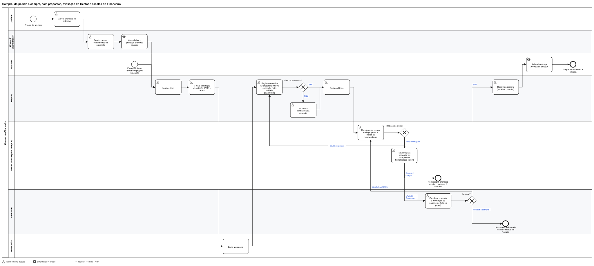
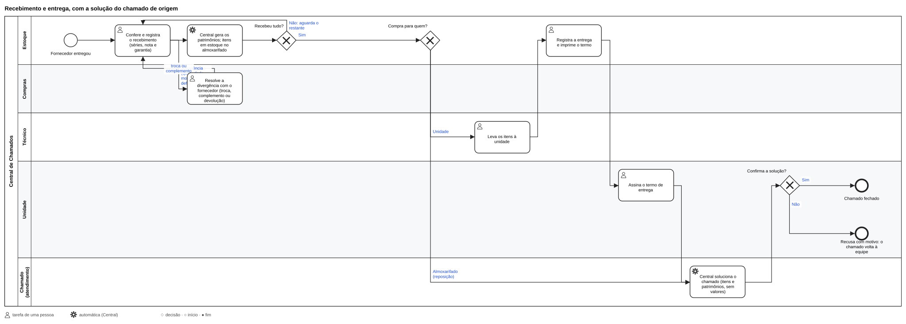

# Compras

Manual de quem pede, cota, avalia, autoriza, recebe e entrega as compras de TI. O módulo **🛒 Compras** (painel ›
Módulos) funciona com ou sem o **📦 Estoque**; o que muda sem ele está em [Sem o Estoque](#sem-o-estoque). Fornecedores
e serviços: [Suprimentos](23-suprimentos.md). Equipamentos e consumíveis: [Estoque](18-estoque.md).

## Em uma página

**Etapas:** Em cotação → Com o Gestor → Com o Financeiro → Autorizado → Comprado → Recebido (em parte ou todo) →
Concluído. Fins sem compra: **Cancelado** (antes de *Comprado*) e **Recusado** (pelo Gestor ou pelo Financeiro), sempre
com o motivo.

| Quem | O que faz | Onde |
| --- | --- | --- |
| **Técnico** (ou quem atende o chamado) | Pede a compra a partir do chamado | Ficha do chamado › subchamado de **aquisição** |
| **Estoque** | Pede reposição ou faz uma requisição; recebe e entrega (com o Estoque ligado) | Menu **Compras** · **Estoque** |
| **Compras** | Monta os itens, pede e registra as cotações, envia ao Gestor, registra a compra, resolve divergências | Menu **Compras** |
| **Gestor de estoque e compras** | Avalia as propostas, devolve, envia ao Financeiro ou recusa | Menu **Compras** (filtro *Com o Gestor*) |
| **Financeiro** | Escolhe a proposta e a condição de pagamento, autoriza, devolve ou recusa | Menu **Financeiro** |
| **Compras**, sem o Financeiro no sistema | Imprime o pedido, colhe a assinatura de quem autoriza e anexa o escaneado | Ficha do pedido › **Autorização em papel** |

**Regras que valem sempre:**
- **Ninguém aprova o próprio pedido.** Quem enviou pela TI não autoriza pelo Financeiro.
- **O Estoque não vê valores nem propostas.** Compras, o Gestor e o Financeiro veem.
- **Não há lembretes em horários fixos.** O que está parado (2 dias ou mais na etapa) ou atrasado aparece em vermelho
  na tela Compras e no contador do menu de quem precisa agir.

## Antes de começar (uma vez)

1. **Ligue o módulo** em painel › Módulos › 🛒 Compras (e o 🏢 Fornecedores, que ele usa).
2. **Dê os papéis** em **Usuários**, na ficha de cada pessoa: *Compras*, *Gestor de estoque e compras*, *Financeiro* e,
   para quem recebe e entrega, *Estoque*. Uma pessoa pode ter vários.
3. **Dados da empresa** (Personalização › Dados da empresa, administrador): razão social, CNPJ, endereço e o e-mail para
   cotações. Eles saem na solicitação de cotação e na ordem de compra.
4. **Cotações do padrão** (Estoque › Configuração › Compras, só o Gestor): quantas propostas a compra precisa (padrão
   3, de 1 a 10) e se a Central avisa quem precisa agir em cada etapa. Sem o módulo Estoque, essa tela não aparece e
   vale o padrão de 3.
5. **Fornecedores** marcados como *vende* (menu **Fornecedores**). Um fornecedor novo também pode ser cadastrado direto na
   proposta (veja abaixo).

## 1. Pedir uma compra

São quatro caminhos, e todos geram o mesmo **pedido de compra**:

- **Pelo chamado (o mais comum).** Na ficha do chamado, abra um subchamado do tipo **aquisição** (no painel) ou toque em
  **Pedir compra** em *📦 Equipamentos e itens* (no aplicativo do técnico). O pedido nasce com o título, a descrição, a
  unidade e o vínculo com o chamado, que fica **pendente** enquanto a compra anda.
- **Reposição de consumível** (com o Estoque): em *Estoque › Consumíveis* ou no início do estoque, **Pedir compra** no item
  abaixo do mínimo abre o pedido com a quantidade que falta. Se já houver um pedido em andamento com o mesmo item e
  almoxarifado, ele não abre outro.
- **Requisição** (papel Estoque): *Compras › Nova requisição de compra*. Descreva o que precisa; Compras inclui os itens.
- **Pedido direto** (papel Compras): *Compras › Novo pedido de compra*.

O número de um chamado pode ser informado na abertura ou depois, em **Editar**.

## 2. Cotar (Compras)

Abra o pedido pela tela **Compras** (filtro *Em cotação*).

1. **Itens.** Para cada item:
   - **Equipamento**: o tipo e a especificação. Cada unidade recebe patrimônio no recebimento.
   - **Consumível**: escolhido do catálogo do Estoque (só com o Estoque ligado).
   - **Outro item**: cabo, licença, móvel, o que não é equipamento nem consumível.

   Cada item mostra o **último preço pago** pelo mesmo item ou modelo. Depois que há propostas registradas, os itens
   ficam travados.
2. **Solicitação de cotação.** Gere o PDF (por fornecedor ou genérico), com os dados da empresa, o número da
   solicitação, os itens, o local de entrega, o prazo para resposta e o que a proposta deve informar. Envie pelo seu
   e-mail.
3. **Registrar cada proposta.** Informe:
   - o **fornecedor**, que precisa estar marcado como *vende* (ou **+ Novo fornecedor**);
   - o **valor unitário** de cada item e a **marca e o modelo** (obrigatórios nos equipamentos);
   - a **loja ou contato** de onde veio a proposta, quando o fornecedor tem mais de uma loja ou vendedor (opcional;
     veja [Contatos e lojas](23-suprimentos.md#contatos-e-lojas));
   - o **prazo**, o **nº da proposta** e a **validade**;
   - o **frete** (incluso ou o valor, que entra no total);
   - as **condições de pagamento**, uma ou mais: à vista (boleto com vencimento numa data ou em dias após a nota, Pix,
     transferência, dinheiro), faturado (ex.: 30/60/90) ou cartão de crédito (com o máximo de parcelas).

   Se a proposta tiver erro, nada é gravado e o que foi digitado volta preenchido para corrigir.
4. **Revisar** uma proposta abre uma nova rodada: a revisão vira a atual e a anterior fica *substituída*, no histórico.
5. **Enviar ao Gestor.** Com menos propostas válidas que o padrão, escreva a **justificativa**.

**Fornecedor novo direto na proposta** (*+ Novo fornecedor*): se o CNPJ já existe, a Central usa o cadastro existente;
se o nome é parecido com outro, pede a confirmação. O novo nasce ativo, *vende*, e marcado como **completar cadastro**
em Fornecedores.

**Compra pela internet:** o fornecedor tem **canal de venda** (loja ou representante, loja online, vendedor em
plataforma como Mercado Livre ou Magalu), plataforma e site. Na proposta de um fornecedor online entram o **link do
anúncio** e o *código do anúncio* no lugar do nº da proposta, e a validade sugerida é o dia seguinte. Ele não aparece na
solicitação de cotação. Sem CNPJ no cadastro, o recebimento pede o **CNPJ da nota** e completa o fornecedor.

## 3. Avaliar (Gestor de estoque e compras)

Abra o pedido pela tela **Compras** (filtro *Com o Gestor*, que conta no menu). A avaliação é feita no **mapa
comparativo**, a mesma tela que Compras e o Financeiro usam:

- os fornecedores vão do mais barato ao mais caro, e o menor preço de cada item fica em verde;
- os destaques do topo mostram o menor total, o menor prazo, a recomendada e a validade mais curta;
- os alertas do cabeçalho mostram as propostas sem prazo, sem validade ou com a validade vencida (essa pede a
  confirmação de ciência);
- o filtro **Todas · Homologadas · A avaliar** e *Mostrar detalhes* (nº, arquivo, link, observação) ajudam a comparar.

Na linha **Avaliação** de cada proposta: *decidir depois*, **homologar** ou **recusar** (com o motivo). Marque **uma ou
mais recomendadas**. Depois, escolha:

- **Devolver para completar as cotações**, com a resposta a Compras. As homologadas continuam valendo e só as novas
  voltam para avaliação (a tela mostra "x de 3 homologadas").
- **Enviar ao Financeiro** com as homologadas. Com menos que o padrão, só com a justificativa de Compras e a exceção
  autorizada por você.
- **Recusar a compra**, com o motivo (veja [Cancelar ou recusar](#cancelar-ou-recusar)).

## 4. Autorizar

Depois que o Gestor envia, o pedido fica **Com o Financeiro**. A autorização acontece de um destes dois jeitos.

### Em papel (sem o Financeiro no sistema)

É o caminho quando ninguém tem o papel **Financeiro** na Central: quem autoriza assina o pedido impresso e Compras
registra. Vale como a autorização do Financeiro. A Central percebe sozinha que não há Financeiro e então:

- **avisa Compras** (e quem abriu o pedido): "imprima o pedido, colha a assinatura de quem autoriza e anexe o
  escaneado";
- põe o pedido no **contador do menu Compras** (e no filtro *com o Financeiro* da tela Compras);
- mostra na ficha: "Ninguém autoriza pelo sistema… anexe em *Autorização em papel*".

Passo a passo (Compras):

1. Na ficha do pedido, em **Autorização em papel**, clique em **Imprima o pedido**. O PDF lista as propostas
   homologadas, com espaço para marcar a escolhida e a condição de pagamento, e os campos para as assinaturas.
2. Leve para quem autoriza: ele marca a proposta e a condição e assina.
3. Escaneie (ou fotografe) o pedido assinado.
4. Ainda em **Autorização em papel**, preencha:
   - **Proposta e condição marcadas no papel**: a mesma que foi marcada à mão;
   - **Quem assinou a autorização**: o nome de quem assinou;
   - **Pedido assinado**: o arquivo (PDF, JPG ou PNG).
5. **Anexar autorização assinada.** O pedido passa para **Autorizado** e segue para a compra (passo 5).

O histórico do pedido registra "Autorizado em papel: assinado por *quem assinou* (anexado por *quem anexou*)", o
arquivo fica no pedido e a ação vai para a Auditoria. As datas de pagamento seguem a condição escolhida. Quem confere é
o Gestor: de vez em quando, abra um pedido autorizado e veja o escaneado.

### No sistema (com o Financeiro)

Quem tem o papel **Financeiro** recebe o aviso e vê, no menu **Financeiro**, as compras para autorizar e as decisões
recentes. Na ficha, o mapa já vem filtrado nas homologadas, com as recomendadas em destaque. Na linha **Escolha**:

1. Escolha **a proposta e a condição de pagamento**.
2. Confira o **plano de pagamento** que aparece: à vista (uma data), boleto (a data da proposta ou pela nota), faturado
   (as parcelas) ou cartão (de 1x até o máximo da proposta, com as datas mensais), com o valor de cada parcela. A tela
   avisa quando uma data foge da proposta. Em branco, o faturado e o boleto em dias após a nota são calculados pela data
   da nota, no recebimento.
3. **Autorize**, ou **devolva ao Gestor** com o motivo, ou **recuse a compra**.

Quem enviou ao Financeiro não autoriza o mesmo pedido. As datas de pagamento vão para o Calendário, para o "a pagar"
dos Painéis e para a ordem de compra. **Abas do Financeiro:** **Equipamentos** (a lista com notas e valores, só
leitura) e **Sem nota fiscal**.

## 5. Comprar (Compras)

Com o pedido **Autorizado** (filtro *autorizados, a comprar*):

1. **Ordem de compra em PDF:** o documento para o fornecedor escolhido, com os dados da empresa, os itens e os valores
   dele, o frete, o prazo e o local de entrega e as datas de pagamento, sem as outras propostas.
2. Feita a compra no fornecedor, **Registrar a compra**: o número do pedido no fornecedor e a previsão de entrega. Se
   algum item chega em outra data, marque *Algum item chega em outra data?* e informe a previsão de cada um. Se o
   fornecedor tem mais de uma loja, escolha **Retirar ou receber em**: a loja de onde sai o equipamento, que pode ser
   outra, não a da proposta. Ela aparece na ficha e na ordem de compra.

Quem tem o papel Estoque é avisado da entrega prevista. Passada a data, o pedido fica em vermelho como **atrasado** (o atraso conta
pelo próximo item que falta).

## 6. Receber

Com o Estoque ligado, quem recebe é o **Estoque**; sem ele, **Compras**. O recebimento pode ser **parcial** (uma entrega
de cada vez). No pedido, **Receber**:

1. Escolha o **almoxarifado** (o padrão já vem marcado).
2. Para cada item: a **quantidade** que chegou, a **marca e o modelo** (vêm da proposta) e as **séries** dos
   equipamentos.
3. A **nota fiscal**: o número, a data da nota, a data da compra, a **garantia** (em meses, ex. `12`, ou uma data) e o
   arquivo. Para várias entregas com a mesma nota, a Central sugere as notas já registradas no pedido.

Com o Estoque, cada equipamento ganha o **patrimônio na hora** e entra **em estoque** no almoxarifado, com o valor, a
marca, o modelo e o fornecedor na ficha; os consumíveis somam ao saldo. Boleto com vencimento em dias após a nota: a data
é calculada aqui. Datas impossíveis são recusadas (garantia antes da compra, nota ou compra no futuro, nota antes da
autorização).

### Divergência

Chegou faltando, com outro modelo ou com defeito? Registre a **divergência** no próprio recebimento. As unidades com
problema não entram e o pedido volta para **Compras** resolver com o fornecedor:

- **Troca** ou **complemento**: as unidades continuam a receber;
- **Devolução sem reposição**: a quantidade do item diminui e o pedido pode se concluir.

## 7. Entregar à unidade

No pedido recebido (filtro *a entregar à unidade*), **Entregar** registra a entrega de tudo o que foi recebido e ainda não
foi entregue, com o **termo de entrega** em PDF para colher a assinatura. Com o Estoque, os equipamentos passam para a
unidade (em uso), com a movimentação no histórico.

## O chamado de origem

- Fica **pendente** durante a compra e recebe um **acompanhamento privado** a cada etapa, sem valores.
- É **solucionado** pela Central quando a compra chega a quem pediu: na **última entrega** à unidade ou, na reposição
  do almoxarifado, no **recebimento** total. A solução descreve o pedido, os itens e os patrimônios, sem valores, e a
  unidade aprova ou recusa como em qualquer chamado.

## Cancelar ou recusar

- **Cancelar** (antes de *Comprado*): quem abriu o pedido, Compras ou o Gestor, com o motivo.
- **Recusar**: o Gestor ou o Financeiro, com o motivo.

Ao cancelar ou recusar, o Gestor e Compras escolhem entre **Encerrar e avisar a unidade** (o chamado é cancelado, com
um acompanhamento visível à unidade com o motivo, sem pesquisa de satisfação) ou **Deixar com a equipe para outra
solução**. Recusada pelo Financeiro, o chamado **sempre volta para a TI**, e o Gestor e Compras são avisados. Um pedido
cancelado ou recusado não volta sozinho: para tentar de novo, abra outro.

## Avisos

Pelo **sino**, pelo **push** do celular (para quem ligou os avisos no aplicativo) e pelo e-mail reserva, para quem
precisa agir:

| Acontecimento | Quem é avisado |
| --- | --- |
| Pedido novo, pedido devolvido pelo Gestor | Compras |
| Propostas para avaliar, devolvido pelo Financeiro | Gestor |
| Homologadas enviadas | Financeiro; sem ninguém com o papel Financeiro, Compras e quem abriu (autorização em papel) |
| Autorizado | Compras e quem abriu |
| Compra feita, com a entrega prevista | Quem tem o papel Estoque |
| Divergência no recebimento / resolvida | Compras / Estoque |
| Cancelado ou recusado | Compras, Gestor e quem abriu |

Cada aviso tem o link da ficha, que abre **na rede interna**.

## Documentos (PDF)

Todos no padrão de documento da Personalização (papel timbrado e margens): **pedido de compra** (interno; sem valores
para o Estoque), **solicitação de cotação**, **mapa comparativo**, **ordem de compra** (para o fornecedor escolhido) e
**termo de entrega**.

## Sem o Estoque

Compras funciona sozinho:

- Itens: **equipamento** e **outro item** (o **consumível** precisa do Estoque, porque vem do catálogo dele).
- **Compras recebe e entrega.** O recebimento registra as quantidades, as divergências, a nota e as **séries** (no
  registro), sem almoxarifado nem patrimônio. A entrega conclui o pedido e soluciona o chamado.
- A reposição pelo estoque mínimo não existe (é do Estoque).
- As **cotações do padrão** ficam em 3 (a tela de configuração é a do Estoque).
- O menu **Painéis** (com a aba Compras) também é do Estoque: sem ele, o acompanhamento é pela tela Compras e pelo
  Calendário.
- O aviso de "compra feita" vai para quem tem o papel Estoque: sem o módulo, acompanhe pelo filtro *a receber do
  fornecedor*.

## Painéis e calendário

- **Painéis › Compras**: o funil por etapa com o tempo médio em cada uma (12 meses), os parados, as entregas atrasadas,
  o prazo prometido × o real, as exceções de cotação e as divergências; para quem vê valores, o valor por mês, por
  categoria e por fornecedor, e a diferença entre a escolhida e a mais cara (e a mais barata) homologada.
- **Painéis › Projeções**: o gasto comprometido (autorizado e não concluído), o *a pagar* e a tendência dos 6 meses.
- **Painéis › Relatórios**: compras com valores (Compras, Gestor, Financeiro), em PDF e CSV, com período e unidade.
- **Calendário**: as entregas previstas (Estoque, Compras), a validade das propostas (Compras, Gestor) e os
  vencimentos de pagamento (Financeiro).

## Problemas comuns

| Situação | O que fazer |
| --- | --- |
| Não consigo mudar os itens | Já há proposta registrada: os itens travam. Remova as propostas ou abra outro pedido |
| "Enviar ao Gestor" pede justificativa | Há menos propostas válidas que o padrão: explique por que (fornecedor único, urgência) |
| O Financeiro não vê o botão de autorizar | Quem enviou pela TI não autoriza; outra pessoa com o papel Financeiro autoriza |
| O pedido está *com o Financeiro* e ninguém tem esse papel | Autorização em papel: imprima, colha a assinatura e anexe (passo 4) |
| O pedido está em vermelho | Parado há 2 dias ou mais na etapa, ou a entrega passou da previsão |
| O Estoque não vê os valores | É de propósito: só Compras, o Gestor e o Financeiro veem valores |
| O fornecedor não aparece na proposta | Ele precisa estar ativo e marcado como *vende* em Fornecedores |
