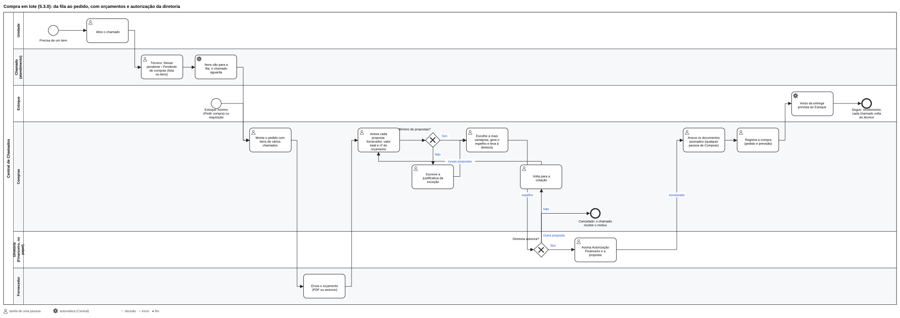
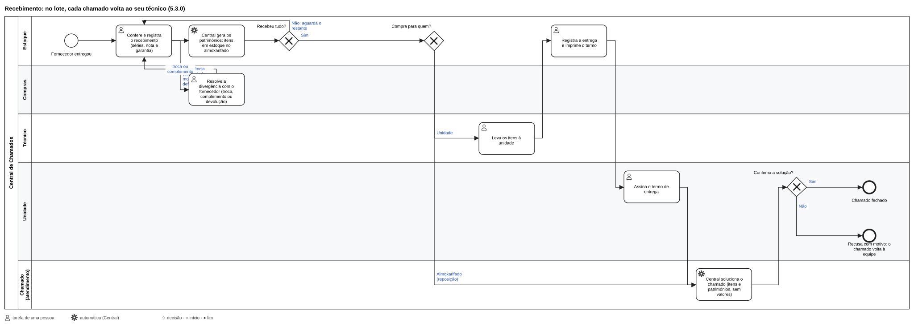

# Compras

Manual de quem pede, cota, avalia, autoriza, recebe e entrega as compras de TI. O módulo **🛒 Compras** (painel ›
Módulos) funciona com ou sem o **📦 Estoque**; o que muda sem ele está em [Sem o Estoque](#sem-o-estoque). Fornecedores
e serviços: [Suprimentos](23-suprimentos.md). Equipamentos e consumíveis: [Estoque](18-estoque.md).

## Em uma página

**5.3.0: compras em lote.** O que os chamados pedem **não abre pedido sozinho**: vira item na **fila de compras**, e um
comprador junta os itens que fazem sentido num pedido só. Uma cotação atende vários chamados.

**5.2.5: a proposta é o arquivo.** Cada proposta é só **fornecedor, valor total, nº do orçamento e arquivo** (PDF ou
print do anúncio); quem cota **escolhe a mais vantajosa e gera o espelho**, que vai à diretoria: o Financeiro assina o
**espelho do pedido** (página 1) e o **arquivo da proposta escolhida** (páginas seguintes). 5.2.6: **sem aprovação do
Gestor** nesse caminho.

**Etapas, com o Financeiro fora do sistema (o caso da Tudo):** Em cotação → **Autorização** (a diretoria, pelo Financeiro, no
papel) → Autorizado → Comprado → Recebido (em parte ou todo) → Concluído.
**Com alguém no papel Financeiro:** Em cotação → Com o Gestor → Com o Financeiro → Autorizado → Comprado → Recebido →
Concluído. Fins sem compra: **Cancelado** (antes de *Comprado*) e **Recusado** (pelo Gestor ou pelo Financeiro), sempre
com o motivo.

| Quem | O que faz | Onde |
| --- | --- | --- |
| **Técnico** (ou quem atende o chamado) | Lista o que precisa comprar; os itens vão para a fila. Retira no almoxarifado quando chega, instala e soluciona o chamado | Ficha do chamado › **Deixar pendente › Pendente de compras** |
| **Estoque** | Pede reposição ou faz uma requisição; recebe e entrega (com o Estoque ligado) | Menu **Compras** · **Estoque** |
| **Compras** | Cuida da fila (deixa os itens mais específicos, cancela o que não vem), monta os pedidos, pede os orçamentos, anexa as propostas, escolhe a mais vantajosa e gera o espelho, leva à diretoria, anexa os documentos assinados, registra a compra, resolve divergências | Menu **Compras** e **Compras › Fila de compras** |
| **Diretoria (Financeiro)**, fora do sistema | Assina **Autorização Financeiro** no espelho (o único campo de assinatura) e a proposta do fornecedor | O papel |
| **Financeiro** (no sistema, se houver) | Escolhe a condição de pagamento, autoriza, devolve ou recusa | Menu **Financeiro** |

**Regras que valem sempre:**
- **Ninguém aprova o próprio pedido.** Quem enviou pela TI não autoriza pelo Financeiro.
- **O Estoque não vê valores nem propostas.** Compras, o Gestor e o Financeiro veem.
- **Não há lembretes em horários fixos.** O que está parado (2 dias ou mais na etapa) ou atrasado aparece em vermelho
  na tela Compras e no contador do menu de quem precisa agir.

## Antes de começar (uma vez)

1. **Ligue o módulo** em painel › Módulos › 🛒 Compras (e o 🏢 Fornecedores, que ele usa).
2. **Dê os papéis** em **Usuários**, na ficha de cada pessoa: *Compras*, *Gestor de estoque e compras*, *Financeiro* e,
   para quem recebe e entrega, *Estoque*. Uma pessoa pode ter vários.
3. **Dados da empresa** (Personalização › Dados da empresa, administrador): razão social, CNPJ, endereço e o e-mail para
   cotações. Eles saem no pedido de orçamento e na ordem de compra.
4. **Cotações do padrão** (Estoque › Configuração › Compras, só o Gestor): quantas propostas a compra precisa (padrão
   3, de 1 a 10) e se a Central avisa quem precisa agir em cada etapa. Sem o módulo Estoque, essa tela não aparece e
   vale o padrão de 3.
5. **Fornecedores** marcados como *vende* (menu **Fornecedores**). Um fornecedor novo também pode ser cadastrado direto na
   proposta (veja abaixo).

## 1. Pedir uma compra

- **Pelo chamado (o mais comum).** Na ficha do chamado, **Mais ações › Deixar pendente › Pendente de compras** (no
  painel ou no aplicativo do técnico): abre uma janela com **uma linha por item** (quantidade e descrição). A Central
  cria o subchamado de compra (nº X.1) e manda os itens para a **fila de compras**; **nenhum pedido nasce aqui**. O
  chamado fica **pendente** e volta ao técnico quando a compra chega ao almoxarifado.
  Escreva do seu jeito: se não souber o modelo, descreva o problema ("toner da impressora da loja 3"). Compras deixa
  mais específico antes de pedir orçamento, e o texto original continua visível.
- **Reposição e requisição** continuam abrindo pedido direto (não passam pela fila): são do estoque, não de um chamado.
- **Reposição de consumível** (com o Estoque): em *Estoque › Consumíveis* ou no início do estoque, **Pedir compra** no item
  abaixo do mínimo abre o pedido com a quantidade que falta. Se já houver um pedido em andamento com o mesmo item e
  almoxarifado, ele não abre outro.
- **Requisição** (papel Estoque): *Compras › Nova requisição de compra*. Descreva o que precisa; Compras inclui os itens.
- **Pedido direto** (papel Compras): *Compras › Novo pedido de compra*.

## 1b. A fila de compras (5.3.0)

**Compras › Fila de compras** mostra o que os chamados pediram e ainda não entrou em pedido: quantidade, item,
**chamado**, **unidade de destino** e **há quantos dias espera**. O número de dias é só informação — quem julga a
urgência é a equipe; se algo for urgente, monte um pedido com um item só.

- **Um por um** ou **juntar os iguais** (soma os itens de mesma descrição e mostra cada chamado). O agrupamento é só da
  tela: no pedido, cada item continua separado, com o seu chamado e a sua unidade.
- **Mudar:** deixe o item mais específico — é esse texto que o fornecedor vai ler no pedido de orçamento. O que o
  técnico pediu fica guardado e aparece embaixo.
- **Cancelar o item:** exige o motivo e **avisa o técnico do chamado**, que decide o que fazer.
- **Montar pedido:** marque os itens que fazem sentido pedir ao mesmo fornecedor, informe o título e o almoxarifado que
  vai receber, e a Central abre **um pedido** com todos eles.

No pedido em lote, cada item mostra o **chamado** e o **destino**. Não se inclui nem remove item ali: a origem é a
fila. Se a proposta escolhida não cobrir algum item, use **Devolver itens para a fila** — ele volta a esperar e o
técnico do chamado é avisado de que vai demorar mais.

O número de um chamado pode ser informado na abertura ou depois, em **Editar**.

## 2. Cotar (Compras)

1. **Incluir os itens** (tipo, quantidade e especificação). Cada item mostra o **último preço pago**.
2. **Pedir as propostas** aos fornecedores (o **pedido de orçamento** em PDF, genérico, serve para todos).
3. **Anexar cada proposta** (*Registrar proposta*): o **fornecedor** (da lista ou *+ Novo fornecedor*), o **valor
   total** (com frete, se houver) e o **arquivo** da proposta, obrigatório: o PDF do fornecedor ou o anúncio salvo em
   PDF (Ctrl+P) ou como imagem. Não se digita mais item por item, marca, prazo, validade nem condição de pagamento: o
   arquivo diz. Errou? **Revisar** abre uma nova rodada e a anterior fica no histórico.
4. O quadro das propostas mostra o **total** de cada uma (o menor em verde) e o link **abrir o arquivo**.

## 3. Escolher e enviar para autorização (Compras)

Em **Enviar para autorização**:
1. **Escolha a mais vantajosa.** As propostas aparecem da menor para a maior; a de **menor valor** já vem marcada.
2. Se escolher outra, escreva o **motivo da escolha** (ex.: entrega em 2 dias). Ele **sai impresso no espelho**.
3. Com menos propostas que o padrão, escreva a **justificativa** da exceção (também sai impressa).
4. Clique em **Gerar o espelho e enviar para autorização**. A escolhida fica fixada no pedido; as outras ficam *não
   escolhidas*.
5. **Imprima o pedido**: página 1 com o **espelho** (aberto em, aberto por e chamado; os dados do chamado: nº, data e
   hora, unidade, quem pediu e técnico; os itens; a proposta escolhida e quem escolheu; o motivo e a justificativa, se
   houver; o campo **Autorização Financeiro**) e, nas páginas seguintes, o **arquivo da proposta**.

## 4. Autorização da diretoria (sem o Financeiro no sistema)

1. Leve o pedido impresso à diretoria: o **Financeiro** assina **Autorização Financeiro** no espelho (é o único campo
   de assinatura) e assina a **proposta do fornecedor**. Não há aprovação do Gestor no sistema.
2. Com os documentos de volta, **qualquer pessoa de Compras** escaneia e, na ficha do pedido, em **Autorização da
   diretoria**, preenche **Quem assinou pelo Financeiro**, anexa o arquivo e clica em **Anexar documentos assinados**.
   O pedido segue direto para a **compra**.
3. A diretoria pediu outra proposta: **Voltar para a cotação** (com o motivo); a escolha é desfeita e todas as
   propostas voltam a valer. Para desistir, **Cancelar** (com o motivo).

O escaneado fica no pedido: é a prova da autorização. O histórico registra quem anexou e quem assinou pelo Financeiro.

### Com o Financeiro no sistema

Se alguém tiver o papel **Financeiro**, o caminho pelo sistema continua: o Gestor confirma a escolha em **Aprovar a
escolhida e enviar ao Financeiro** e o Financeiro, no menu **Financeiro**, escolhe a condição de pagamento e autoriza,
devolve ao Gestor ou recusa.

### Pedidos de antes da 5.2.5

Os pedidos enviados ao Gestor antes da 5.2.5 (sem a escolha) seguem como estavam: o Gestor escolhe e aprova no sistema
e Compras anexa a autorização em papel. As propostas antigas mantêm os dados que tinham (frete, prazo, validade,
condições), e o quadro os mostra.

## 5. Comprar (Compras)

Com o pedido **Autorizado** (filtro *autorizados, a comprar*):

1. **Ordem de compra em PDF:** o documento para o fornecedor escolhido, com os dados da empresa, os itens e os valores
   dele, o frete, o prazo e o local de entrega e as datas de pagamento, sem as outras propostas.
2. Feita a compra no fornecedor, **Registrar a compra**: o número do pedido no fornecedor e a previsão de entrega. Se
   algum item chega em outra data, marque *Algum item chega em outra data?* e informe a previsão de cada um. Se o
   fornecedor tem mais de uma loja, escolha **Retirar ou receber em**: a loja de onde sai o equipamento, que pode ser
   outra, não a da proposta. Ela aparece na ficha e na ordem de compra.

Quem tem o papel Estoque é avisado da entrega prevista. Passada a data, o pedido fica em vermelho como **atrasado** (o atraso conta
pelo próximo item que falta).

## 6. Receber

Com o Estoque ligado, quem recebe é o **Estoque**; sem ele, **Compras**. O recebimento pode ser **parcial** (uma entrega
de cada vez). No pedido, **Receber**:

1. Escolha o **almoxarifado** (o padrão já vem marcado).
2. Para cada item: a **quantidade** que chegou, a **marca e o modelo** (vêm da proposta) e as **séries** dos
   equipamentos.
3. A **nota fiscal**: o número, a data da nota, a data da compra, a **garantia** (em meses, ex. `12`, ou uma data) e o
   arquivo. Para várias entregas com a mesma nota, a Central sugere as notas já registradas no pedido.

Com o Estoque, cada equipamento ganha o **patrimônio na hora** e entra **em estoque** no almoxarifado, com o valor, a
marca, o modelo e o fornecedor na ficha; os consumíveis somam ao saldo. Boleto com vencimento em dias após a nota: a data
é calculada aqui. Datas impossíveis são recusadas (garantia antes da compra, nota ou compra no futuro, nota antes da
autorização).

### Divergência

Chegou faltando, com outro modelo ou com defeito? Registre a **divergência** no próprio recebimento. As unidades com
problema não entram e o pedido volta para **Compras** resolver com o fornecedor:

- **Troca** ou **complemento**: as unidades continuam a receber;
- **Devolução sem reposição**: a quantidade do item diminui e o pedido pode se concluir.

## 7. Entregar à unidade

No **pedido em lote** não há esta etapa: ele conclui no recebimento e quem leva a peça até a loja é o técnico do
chamado (veja *O chamado de origem*). O que segue vale para os pedidos de um chamado só.

No pedido recebido (filtro *a entregar à unidade*), **Entregar** registra a entrega de tudo o que foi recebido e ainda não
foi entregue, com o **termo de entrega** em PDF para colher a assinatura. Com o Estoque, os equipamentos passam para a
unidade (em uso), com a movimentação no histórico.

## O chamado de origem

- Fica **pendente** durante a compra e recebe um **acompanhamento privado** a cada etapa, sem valores.
- **No pedido em lote (5.3.0):** recebida a compra no almoxarifado, o pedido **conclui ali** e cada chamado **volta ao
  seu técnico** — o subchamado de Compra fecha e o chamado é retomado, com a lista do que chegou. O técnico retira com
  o Estoque, instala e **soluciona o chamado**: quem sabe que o problema acabou é ele, não o sistema.
  Chamado que ainda espera item em outro pedido continua aguardando e só recebe o aviso do que já chegou; recebimento
  parcial não libera ninguém.
- **Nos pedidos de um chamado só** (reposição, requisição, pedidos anteriores à 5.3.0): é **solucionado** pela Central
  na **última entrega** à unidade ou, na reposição do almoxarifado, no **recebimento** total.

## Cancelar ou recusar

- **Cancelar** (antes de *Comprado*): quem abriu o pedido, Compras ou o Gestor, com o motivo.
- **Recusar**: o Gestor ou o Financeiro, com o motivo.

Ao cancelar ou recusar, o Gestor e Compras escolhem entre **Encerrar e avisar a unidade** (o chamado é cancelado, com
um acompanhamento visível à unidade com o motivo, sem pesquisa de satisfação) ou **Deixar com a equipe para outra
solução**. Recusada pelo Financeiro, o chamado **sempre volta para a TI**, e o Gestor e Compras são avisados. Um pedido
cancelado ou recusado não volta sozinho: para tentar de novo, abra outro.

## Avisos

Pelo **sino**, pelo **push** do celular (para quem ligou os avisos no aplicativo) e pelo e-mail reserva, para quem
precisa agir:

| Acontecimento | Quem é avisado |
| --- | --- |
| Pedido novo, pedido devolvido pelo Gestor | Compras |
| Propostas para avaliar, devolvido pelo Financeiro | Gestor |
| Homologadas enviadas | Financeiro; sem ninguém com o papel Financeiro, Compras e quem abriu (autorização em papel) |
| Autorizado | Compras e quem abriu |
| Compra feita, com a entrega prevista | Quem tem o papel Estoque |
| Divergência no recebimento / resolvida | Compras / Estoque |
| Cancelado ou recusado | Compras, Gestor e quem abriu |

Cada aviso tem o link da ficha, que abre **na rede interna**.

## Documentos (PDF)

Todos no padrão de documento da Personalização (papel timbrado e margens): **pedido de compra** (com a proposta
escolhida, é o **espelho** na página 1 e o arquivo da proposta nas seguintes, para as assinaturas; sem valores para o
Estoque), **pedido de orçamento**, **mapa comparativo**, **ordem de compra** (para o fornecedor escolhido) e
**termo de entrega**. Com o timbrado compacto (cabeçalho de até 3 cm, margens de 2,9 cm e 2,0 cm), o espelho cabe numa
página.

## Sem o Estoque

Compras funciona sozinho:

- Itens: **equipamento** e **outro item** (o **consumível** precisa do Estoque, porque vem do catálogo dele).
- **Compras recebe e entrega.** O recebimento registra as quantidades, as divergências, a nota e as **séries** (no
  registro), sem almoxarifado nem patrimônio. A entrega conclui o pedido e soluciona o chamado.
- A reposição pelo estoque mínimo não existe (é do Estoque).
- As **cotações do padrão** ficam em 3 (a tela de configuração é a do Estoque).
- O menu **Painéis** (com a aba Compras) também é do Estoque: sem ele, o acompanhamento é pela tela Compras e pelo
  Calendário.
- O aviso de "compra feita" vai para quem tem o papel Estoque: sem o módulo, acompanhe pelo filtro *a receber do
  fornecedor*.

## Painéis e calendário

- **Painéis › Compras**: o funil por etapa com o tempo médio em cada uma (12 meses), os parados, as entregas atrasadas,
  o prazo prometido × o real, as exceções de cotação e as divergências; para quem vê valores, o valor por mês, por
  categoria e por fornecedor, e a diferença entre a escolhida e a mais cara (e a mais barata) homologada.
- **Painéis › Projeções**: o gasto comprometido (autorizado e não concluído), o *a pagar* e a tendência dos 6 meses.
- **Painéis › Relatórios**: compras com valores (Compras, Gestor, Financeiro), em PDF e CSV, com período e unidade.
- **Calendário**: as entregas previstas (Estoque, Compras), a validade das propostas (Compras, Gestor) e os
  vencimentos de pagamento (Financeiro).

## Problemas comuns

| Situação | O que fazer |
| --- | --- |
| Não consigo mudar os itens | Já há proposta registrada: os itens travam. Remova as propostas ou abra outro pedido |
| "Enviar ao Gestor" pede justificativa | Há menos propostas válidas que o padrão: explique por que (fornecedor único, urgência) |
| O Financeiro não vê o botão de autorizar | Quem enviou pela TI não autoriza; outra pessoa com o papel Financeiro autoriza |
| O pedido está *com o Financeiro* e ninguém tem esse papel | Autorização em papel: imprima, colha a assinatura e anexe (passo 4) |
| O pedido está em vermelho | Parado há 2 dias ou mais na etapa, ou a entrega passou da previsão |
| O Estoque não vê os valores | É de propósito: só Compras, o Gestor e o Financeiro veem valores |
| O fornecedor não aparece na proposta | Ele precisa estar ativo e marcado como *vende* em Fornecedores |

## 5.3.2: nome do pedido, situação do subchamado e cancelamento

- O pedido montado da fila **exige nome** (e aceita descrição). O antigo "Compras em lote · data" obrigava a equipe a
  abrir o pedido para saber do que se tratava. **Editar** renomeia um pedido já existente.
- No pedido em lote, os campos "Para quem é" e "Chamado nº" não aparecem: o destino é o chamado de cada item.
- O **subchamado de Compra** não usa a régua dos técnicos. A situação dele é o estágio da compra — *Na fila de
  compras*, *Em pedido nº N*, *Comprado*, *Recebido*, *Compra cancelada* — e o número do pedido aparece ao lado, no
  atendimento, assim que o lote é montado.
- **Cancelado o último item vivo de um chamado, o subchamado é cancelado** (não solucionado: não houve solução) e o
  chamado de origem volta ao atendimento. Até a 5.3.1 nada fazia isso: o técnico recebia o aviso e o subchamado
  ficava aberto para sempre.

## 5.3.4: saída para o subchamado de Compra órfão

A ficha do subchamado de Compra esconde as ações do técnico de propósito (`sub_simples` no template): quem move a
compra é Compras. O efeito colateral aparecia quando o subchamado ficava **sem item na fila e sem pedido vivo** —
caso dos subchamados anteriores à 5.3.0, que nasceram com um pedido direto, quando esse pedido era cancelado.
Compras não tinha mais o que fazer, o técnico não tinha botão, e o chamado de origem esperava indefinidamente.

- A ficha reconhece esse estado, explica (`Pedido nº 9 foi cancelado e nada mais liga esta compra a Compras`) e
  oferece **Cancelar o subchamado** com motivo obrigatório; o chamado de origem volta ao atendimento.
- A situação também deixa de mentir: sem item na fila, o rótulo vem do pedido ligado (`Pedido nº 9: Cancelado`) em
  vez de "Na fila do grupo", que nunca foi verdade para uma compra.
- A partir da 5.3.3 esse estado não nasce mais sozinho; isto é a saída para o que já existe.

## 5.3.5: necessidades sem subchamado e acionamento de terceiro

- **Necessidade sem subchamado** (as que a migração 35 criou a partir das pendências antigas de compra; na Tudo, o
  chamado 45): no recebimento, `solucionar` marcaria o chamado do usuário como solucionado só porque a peça chegou
  ao almoxarifado, antes de alguém instalar — e a solução iria ao usuário. Agora o chamado é **devolvido ao
  atendimento**, com o texto do que chegou. No cancelamento do item, idem: antes ele ficava pendente para sempre.
- **Acionamento de terceiro**: mesma correção que a compra recebeu na 5.3.2. Ele mostrava *Na fila do grupo · Sem
  técnico · Agora: alguém da equipe assumir*, o que é falso — ninguém assume um acionamento, quem age é o
  fornecedor. Passa a mostrar **Com o fornecedor**, na ficha, na árvore e na lista.
